# Grav-Mass Tree — One-Cable, 100% Solder-Free 12V Power Architecture (`POWER_ARCHITECTURE.md`)

> [!IMPORTANT]
> **Engineering Summary:** This document defines the complete electrical power, protection, and distribution architecture for the **Grav-Mass Day "Falling Apple Cascade" Marble Run Tree**. It resolves the voltage incompatibilities of the legacy 5V USB-C setup by operating the entire sculpture from **one external UL-listed 12V DC desktop power adapter** through a **panel-mounted 5.5 × 2.1 mm DC barrel jack**, **branch-fused WAGO 221 lever-nut distribution**, a **dedicated 12V → 5V synchronous buck converter** for the 66 addressable WS2812B LEDs, and a **12V-native N20 gear motor branch** (with a fully documented 6V buck + external H-bridge retrofit path for builders retaining the legacy 6V `LA002` motor). Every internal connection is **100% solder-free**.

---

## 1. Design Rationale & Root-Cause Analysis of Legacy Voltage Incompatibilities

### 1.1 Why the Legacy 5V USB-C Power Arrangement Was Electrically Out of Specification

The legacy documentation proposed powering the sculpture from a 5V USB-C cable plugged into the **M5Stack ATOM Lite (`C008`)** (or feeding 5V into the **M5Stack Atomic H-Driver Base (`A092`)** `VIN` terminal) while driving the **6V Bambu Lab `LA002` N20 motor** and **66× 5V WS2812B addressable LEDs**. Independent verification against manufacturer datasheets and schematics identified four critical incompatibilities:

1. **`A092` Input Voltage Specification (`DC 9–24V` Required):**
   - Per the official [M5Stack Atomic H-Driver Base (`A092`) documentation](https://docs.m5stack.com/en/atom/Atomic_HDriver_Base), `A092` integrates a **Texas Instruments `DRV8876PWPR` H-bridge driver** and an internal **MPS `MP1584EN` step-down DC/DC converter** rated for **`VIN = 9–24V DC`**.
   - The `MP1584EN` buck regulator steps `VIN` (`9–24V`) down to `5.0V` to power the attached `C008` ATOM Lite via its `5V` bus pin. Supplying `5V` to `VIN` fails to meet the regulator dropout headroom (`VIN_min = 9V`).
2. **`C008` ATOM Lite USB-C Schottky Diode & Grove Connector Current Bottleneck (`500 mA` Max):**
   - When powered via the `C008` USB-C port, all current flowing out of the `C008` `5V` rail (including the 4-pin `HY2.0-4P` Grove port) passes through an onboard **`500 mA` Schottky reverse-protection diode (`MBRA140` / `SS14` class)**.
   - Drawing LED current for 66× WS2812B pixels (up to `2.76A–3.96A` at 100% white) + motor current through the `C008` USB-C diode and `26 AWG` Grove traces risks thermal failure of the Schottky diode, severe `5V` rail droop, and ESP32 brownout resets.
3. **Motor Voltage Mismatch (`6V` Rated `LA002` vs. `12V` `A092` H-Bridge Output):**
   - On `A092`, the `DRV8876` H-bridge `VM` supply pin is tied directly to the incoming `VIN` rail (`9–24V`). The `M1`/`M2` motor terminals switch between `VIN` and `GND`.
   - Per the official [Bambu Lab `LA002` N20 Reduction Gear Motor datasheet](https://store.bblcdn.com/s1/default/3c08b682f05248a18eb163890acc7211/N20_Reduction_Gear_Motor.pdf), `LA002` has a **rated voltage of `6.0V DC`** and an **operating range of `3.0–7.0V DC`** (`150 RPM` no-load speed, `852.6 g·cm` rated torque).
   - Supplying `12V` to `A092` and connecting the `6V` `LA002` motor directly to `M1`/`M2` subjects the `6V` motor windings to **`12V` peak pulses (`200%` of rated voltage)** and **`4×` instantaneous $P = V^2 / R$ stall dissipation**, causing commutator arcing, brush wear, overheating, and doubled unloaded speed (`~300 RPM`) unless artificially throttled by a fragile `50%` software PWM ceiling.
4. **`5V` Rail Backfeeding Hazard:**
   - Because `A092`'s onboard `MP1584EN` buck regulator actively drives the `5V` header pin when `VIN = 12V`, connecting an external `12V → 5V` LED buck converter's `+5V` output to the `C008`/`A092` `5V` pin creates a **parallel regulator conflict (backfeeding)** between two unsynchronized buck outputs.

---

## 2. Final Selected Power Architecture & Trade-Off Evaluation

### 2.1 System-Level Architecture Overview (Single `12V` Input → 3 Isolated Fused Branches)

To satisfy all electrical, thermal, mechanical, and zero-solder constraints, the sculpture uses a **single regulated `12V DC` desktop power supply** entering a **panel-mounted `5.5 × 2.1 mm` DC barrel jack** in the rear `-X` root flange of `trunk_base`. Inside the `Ø 135 × 50 mm` (`> 150 cm³`) Hollow Root Vault, `WAGO 221-415` lever-nut blocks split the incoming `12V` rail into **three independently fused branches**:

1. **Branch 1 — Controller & Motor Logic (`12V` → Fuse `F1` → `A092` `VIN`/`GND` → `C008` ATOM Lite):**
   - `A092` receives regulated `12.0V DC` (dead-center in its `9–24V` operating window).
   - `A092`'s internal `MP1584EN` buck converter powers the `C008` ATOM Lite ESP32 cleanly at `5.0V`.
   - `GPIO33` monitors the true `12.0V` input bus via `A092`'s onboard `1:10` resistor divider (`1.20V` at ADC pin).
2. **Branch 2 — Addressable RGB LEDs (`12V` → Fuse `F2 (3A)` → Dedicated `12V → 5V 5A` Screw-Terminal Buck Converter → Track & Topper LEDs):**
   - A dedicated synchronous `12V → 5V 5A (25W)` step-down converter (`DFRobot DFR0205` or sealed screw-terminal buck module) with a `1000 µF / 16V` electrolytic bulk capacitor across its output screw terminals powers both WS2812B LED zones:
     - **Sub-Branch 2A:** `50× WS2812B` Helical Track Pebble Wire (`BTF-LIGHTING B0CCS11V7H`), fed at both the bottom starter plug and the built-in mid/end power-injection leads (`GPIO26` data via `330 Ω` series resistor).
     - **Sub-Branch 2B:** `16× WS2812B` Apple Topper Ring (`Sparkleiot B09YTMNGTD`), fed via a dedicated `1 m` `JST-SM` extension cable (`B0CT827QQC`) up the `10 × 8 mm` rear trunk conduit (`GPIO32` data).
   - **Strict `5V` Isolation Rule:** The `Red (+5V)` wire of the `A096` Grove cable from `C008` is **capped/disconnected** (or used solely to power an optional `3.3V → 5V` logic-level shifter IC's low-current $V_{CC}$ pin if needed). The external `5V` LED buck output **never** touches `C008`/`A092`'s `5V` rail. Only `GND`, `GPIO26` (White), and `GPIO32` (Yellow) connect between `C008` and the LED harnesses.
3. **Branch 3 — Archimedes Auger Motor (Trade-Off Evaluation of Option B vs. Option A):**

### 2.2 Detailed Engineering Trade-Off Evaluation: Motor Branch Option B vs. Option A

We evaluated two complete engineering solutions for driving the Archimedes screw motor from the `12V` supply without overvolting a `6V` winding:

| Evaluation Criterion | **Option B (SELECTED PRIMARY): Replace `6V LA002` with `12V 150 RPM N20` Motor on `A092` `M1/M2`** | **Option A (SUPPORTED RETROFIT): Keep `6V LA002` + `12V→6V` Buck + External Screw-Terminal H-Bridge** |
| :--- | :--- | :--- |
| **Voltage Compatibility** | **100% Native (`12V` Motor on `12V` H-Bridge):** Motor winding is rated for `12.0V DC` continuous (`150 RPM` @ `12V`). Driven directly by `A092`'s `12V` TI `DRV8876` output (`0–100%` full-resolution PWM). | **100% Safe (`6V` Motor on `6V` H-Bridge):** `12V → 6.0V 3A` buck converter powers the `VM` pin of an external `DRV8871`/`DRV8876`/`TB67H420FTG` H-bridge (`0–100%` PWM at `6.0V`). |
| **Mechanical CAD Compatibility** | **100% Identical Drop-In (`0.0 mm` CAD change):** Standard `12V 150 RPM N20` gear motors share the exact `10.0 × 12.0 × 25.0 mm` body+gearbox envelope and `Ø 3.0 mm` D-shaft as `LA002`. Slides directly into `Servo_Or_030_Adapter` and `Motor_Clutch_Driver`. | **Requires 2 Extra Modules in Root Vault:** Retains `LA002` in the central tower, but adds a `12V → 6V` buck converter module + an external screw-terminal H-bridge board inside the base vault. |
| **Module Count in Root Vault** | **2 Modules Total:** (1) `A092 + C008` stack, (2) `12V → 5V` LED Buck Converter (+ optional `U190` `INA226` sensor). | **4 Modules Total:** (1) `A092 + C008` stack, (2) `12V → 5V` LED Buck, (3) `12V → 6V` Motor Buck, (4) External H-Bridge Driver. |
| **Solder-Free Terminations** | **14 Terminations (Simplest & Highest Reliability):** Motor wires clamp straight into `A092`'s built-in `M1`/`M2` screw terminals. | **24+ Terminations:** Requires extra `12V` branch fuse `F3`, `6V` buck `IN/OUT` wiring, external H-bridge `VM/GND/OUT1/OUT2` screw terminals, and `IN1/IN2` DuPont logic jumpers from `A092` bottom header. |
| **Hardware Stall & Fault Protection (`GPIO22`)** | **100% Preserved:** Uses `A092`'s onboard TI `DRV8876` current-sense (`IPROPI`), hardware overcurrent protection (`OCP`), thermal shutdown (`TSD`), and active-low `nFAULT` pin (`GPIO22`) to auto-halt jams in ESPHome. | **Degraded unless External Driver Has `nFAULT`:** `A092`'s onboard `DRV8876` sits unloaded (`M1/M2` open), so `GPIO22` no longer sees motor stalls unless wired to an external `DRV8876`/`TB67H420FTG` `FAULT` pin. |
| **`GPIO19` / `GPIO23` Signal Integrity** | **Direct Internal Trace:** `C008` `GPIO19`/`GPIO23` drive the internal `DRV8876` directly inside `A092`. | **Shared Parallel Fan-Out:** On `A092`, `G19` and `G23` are permanently wired to the onboard `DRV8876` (`100 kΩ` pull-downs) AND exposed on the bottom header. Tapping `G19`/`G23` from the bottom header works cleanly (`< 60 µA` load) as long as `A092` `M1`/`M2` are left open. |
| **Added Hardware Cost** | **`~$8–$10`** for a `12V 150 RPM N20` gear motor (replaces `$9` `LA002`). | **`~$14–$18`** for an extra `12V → 6V` screw-terminal buck converter + pre-assembled screw-terminal H-bridge driver. |

> [!TIP]
> **Engineering Selection Decision:**
> - **Primary Architecture (Option B):** Use a **`12V DC 150 RPM N20` Micro Metal Gear Motor** (`10 × 12 × 25 mm`, `Ø 3.0 mm` D-shaft) connected directly to `A092`'s `M1`/`M2` screw terminals. It is the **safest, simplest, most reliable, and most cost-effective** design because it uses the TI `DRV8876` H-bridge already built into `A092` at its native `12V` rating, preserves hardware `GPIO22` fault/stall detection, and eliminates two extra circuit boards.
> - **Supported Retrofit Path (Option A):** For builders who already purchased the `6V` `LA002` motor and prefer not to swap the motor, Section 5.2 and `cad/trunk.py` provide full support and snap-in mounting bays for a **`12V → 6V` buck converter + external screw-terminal H-bridge driver** tapped off `GPIO19`/`GPIO23`.
> - *Why not place a `12V → 6V` buck converter between `A092` `M1/M2` and the motor?* A DC/DC buck converter requires steady unidirectional DC polarity (`+IN` and `-IN`) to charge its input capacitor and run its switching control loop; feeding bidirectional H-bridge PWM (`M1`/`M2` reversing polarity for anti-jam backoff) into a buck converter destroys the converter and prevents reverse motor operation.

---

## 3. Component Specifications & Verified Power Budget

### 3.1 Authoritative Component Specifications

| Subsystem | Component & Model / SKU | Verified Electrical & Physical Specifications | Source / Verification Status |
| :--- | :--- | :--- | :--- |
| **External PSU** | **BTF-LIGHTING `12V 5A (60W)` Power Supply Adapter (`B01D8FLSV8`)** | **Input:** `100–240V AC` (`50–60 Hz`). **Output:** Regulated **`12.0V DC`**, **`5.0A` (`60W`)**. **Plug:** `5.5 × 2.1 mm` center-positive (`AC` wall power cord included). **Protections:** Short-circuit, overload, overvoltage, over-temperature. ETL/CE/FCC/RoHS listed. | [Amazon (`B01D8FLSV8`)](https://www.amazon.com/dp/B01D8FLSV8) |
| **DC Entry Jack** | **Pre-Wired `5.5 × 2.1 mm` Threaded Panel-Mount DC Barrel Jack (`B07C7VSRBG`, `18 AWG`)** | **Rating:** `12–24V DC`, **`5A–10A` continuous** (`<= 30 mΩ` contact resistance). **Mounting:** `Ø 11.2 mm` (`M11 × 0.75`) panel hole with hex nut, lock washer, and `18 AWG` pre-crimped red/black leads. | [Amazon (`B07C7VSRBG`)](https://www.amazon.com/dp/B07C7VSRBG) |
| **Controller Base** | **M5Stack Atomic H-Driver Base (`A092` / `K050`)** | **Input (`VIN`):** **`9–24V DC`** via `HT3.96-4P` (`3.96 mm` pitch) pluggable screw terminal. **H-Bridge IC:** TI `DRV8876PWPR` (`1.5A` continuous, `2.0A` peak, internal OCP/TSD/UVLO). **Internal Buck:** `MP1584EN` (`VIN → 5.0V @ 1.0A` for ATOM). **Pinout:** `G19 = IN1`, `G23 = IN2`, `G22 = nFAULT` (open-drain active LOW), `G33 = VIN × (10 kΩ / 100 kΩ) = VIN / 10`. **Size:** `48.0 × 24.0 × 18.0 mm` (with `C008`). | [M5Stack Store (`A092`)](https://shop.m5stack.com/products/atomic-h-bridge-driver-base-drv8876) |
| **ESP32 Controller** | **M5Stack ATOM Lite (`C008`)** | **MCU:** `ESP32-PICO-D4` (`240 MHz` dual-core, Wi-Fi/BLE). **Supply:** `5.0V` (`120 mA` typ Wi-Fi active, `250 mA` peak TX burst). **GPIO:** `G26` (Grove White), `G32` (Grove Yellow), `G39` (Front Button), `G27` (1× SK6812 RGB status LED). **Size:** `24.0 × 24.0 × 10.0 mm`. | [M5Stack Store (`C008`)](https://shop.m5stack.com/products/atom-lite-esp32-development-kit) |
| **5V LED Buck Converter** | **UCTRONICS `DC 9V–36V to 5V 5A (25W)` Screw-Terminal Buck Converter (`B07XXWQ49N`, Model `U6223`)** | **Input:** `9–36V DC` (`12.0V` nominal). **Output:** Fixed **`5.0V DC`**, **`5.0A` continuous (`25W`)**, synchronous rectification ($\eta \approx 88–92\%$). **Terminals:** Onboard `VIN+/GND` and `OUT+/GND` screw terminals. **Size:** `63.0 × 20.0 × 10.0 mm`. | [Amazon (`B07XXWQ49N`)](https://www.amazon.com/UCTRONICS-Converter-Transformer-Voltage-Regulator/dp/B07XXWQ49N) |
| **Track LEDs (Zone 2)** | **BTF-LIGHTING `DC5V` WS2812B Pebble/Seed Pixel String (`B0CCS11V7H`, `50 LEDs`, `5 m`)** | **Voltage:** **`5.0V DC`**. **Pixels:** `50×` addressable RGB ICs encapsulated in `6.2 × 3.2 mm` oval clear resin drops (`100 mm` spacing). **Manufacturer Rated Power:** `0.1W/LED` = **`5.0W` (`1.00A @ 5V`)** nominal; **Unthrottled 100% Solid White Ceiling:** `36 mA/pebble` = **`1.80A` (`9.0W @ 5V`)** (or `3.00A / 15.0W` using conservative `60 mA/pixel` SMD5050 bound). **Connectors:** Pre-terminated 3-pin `JST-SM` + red/black power-injection pigtails at both ends. | [Amazon (`B0CCS11V7H`)](https://www.amazon.com/dp/B0CCS11V7H) |
| **Topper LEDs (Zone 1)** | **Sparkleiot 16-Bit WS2812B 5050 RGB LED Ring (`B09YTMNGTD`, `Ø 45 mm`)** | **Voltage:** **`5.0V DC`**. **Pixels:** `16×` `WS2812B` `5050` SMD RGB LEDs (`12 mA/channel × 3 = 36–60 mA/LED`). **Unthrottled 100% Solid White Ceiling:** `16 × 60 mA` = **`0.96A` (`4.80W @ 5V`)**; typical animated rainbow = `0.30–0.45A` (`1.5–2.25W`). **Connectors:** Pre-soldered 3-pin `JST-SM` male & female pigtails (`5V`, `DI/DO`, `GND`). | [Amazon (`B09YTMNGTD`)](https://www.amazon.com/dp/B09YTMNGTD) |
| **Auger Motor (Option B — Primary)** | **`12V DC 150 RPM N20` Micro Metal Gear Motor (`B0BFRPMSW6`, `Ø 3 mm` D-Shaft)** | **Rated Voltage:** **`12.0V DC`** (`6–15V` operating range). **Speed:** **`150 RPM` ±10%** at `12V`. **Current:** `35 mA` no-load, **`150–220 mA` rated lifting load** (`2.64W`), **`0.65A` stall current** (`7.80W @ 12V`). **Rated Torque:** `0.90 kg·cm` (`900 g·cm`). **Dimensions:** `10.0 × 12.0 × 25.0 mm` gearbox+body, `Ø 3.0 × 9.0 mm` D-shaft (`2.5 mm` flat). | [Amazon (`B0BFRPMSW6`)](https://www.amazon.com/dp/B0BFRPMSW6) |
| **Auger Motor (Option A — Retrofit)** | **Bambu Lab `LA002` `6V DC 150 RPM N20` Gear Motor** + **`12V→6V 3A` Buck** + **Screw-Terminal `DRV8871` / `TB67H420FTG`** | **Rated Voltage:** **`6.0V DC`** (`3–7V` operating range). **Speed:** `150 RPM` at `6V`. **Rated Torque:** `852.6 g·cm`. **Current:** `50 mA` no-load, `250–300 mA` lifting load (`1.80W @ 6V`), `0.85A` stall (`5.10W @ 6V`). | Verified via [Bambu Lab `LA002` PDF Datasheet](https://store.bblcdn.com/s1/default/3c08b682f05248a18eb163890acc7211/N20_Reduction_Gear_Motor.pdf). |
| **Optional Hardware Telemetry** | **M5Stack Unit `INA226-10A` (`SKU: U190`)** | **Interface:** Plug-and-play Grove `HY2.0-4P` I2C (`0x41` default) + `HT3.96-4P` pluggable screw terminals. **Range:** `0–30V DC`, **`±10A` continuous** (`0.005 Ω` shunt, `1.25 mA` resolution, `±0.1%` accuracy). **Size:** `58.0 × 24.0 × 10.2 mm`. | Verified via M5Stack `U190` (`INA226-10A`) documentation. |
| **Wireless Ornaments** | **8× Single Magnetic LEDs (`KA006`) + 6× Y-Shape Magnetic LEDs (`KC012`/`KC013`)** | **Supply:** Self-contained `CR927` (`KA006`) and `CR1632` (`KC012`/`KC013`) coin-cell batteries (**`0.00A` load on the `12V` external supply**). | Verified via Bambu Lab Maker's Supply specifications. |

---

### 3.2 Complete Power Budget Table (`12V DC` Primary Rail)

The table below calculates both **Typical Continuous Operation** (animated RGB cascade + 6 marbles lifting in the auger) and **Worst-Case Simultaneous Peak Load** (all 66 LEDs at 100% solid white + auger motor stalled + ESP32 Wi-Fi TX burst), including DC/DC buck converter efficiencies ($\eta$) and `5%` wiring/distribution margin:

| Branch & Load | Operating Voltage ($V_{\text{load}}$) | Typical Current ($I_{\text{typ}}$) | Worst-Case Max Current ($I_{\text{max}}$) | Load Power ($P_{\text{load,typ}} \text{ / } P_{\text{load,max}}$) | Buck Efficiency ($\eta$) | 12V Input Power ($P_{\text{in,typ}} \text{ / } P_{\text{in,max}}$) | 12V Input Current ($I_{\text{12V,typ}} \text{ / } I_{\text{12V,max}}$) | Basis (`Verified Spec` vs. `Conservative Bound`) |
| :--- | :---: | :---: | :---: | :---: | :---: | :---: | :---: | :--- |
| **Branch 1: Controller (`A092` + `C008` ESP32 + `G27` LED)** | `5.0V` *(internal to A092)* | `0.12 A` | `0.25 A` | `0.60 W` / `1.25 W` | `82%` *(MP1584EN @ 12V→5V)* | `0.73 W` / `1.52 W` | `0.06 A` / `0.13 A` | **Verified Datasheet:** ESP32 Wi-Fi active (`120 mA`) to TX peak (`240 mA`) + 1× SK6812 (`10 mA`). |
| **Branch 2A: Track LEDs (`50× B0CCS11V7H` Pebble WS2812B)** | `5.0V` | `0.75 A` *(rainbow)* | `1.80 A` *(36 mA/LED)* `[3.00 A @ 60 mA]` | `3.75 W` / `9.00 W` `[15.00 W]` | `88%` *(5V 5A Sync Buck)* | `4.26 W` / `10.23 W` `[17.05 W]` | `0.36 A` / `0.85 A` `[1.42 A]` | **Verified Spec:** BTF-LIGHTING rates `50 LEDs` at `5W (1.0A)` nominal; `36 mA/pebble` (`1.80A`) is actual pebble IC max; `60 mA/LED` (`3.00A`) is conservative SMD5050 ceiling. |
| **Branch 2B: Topper Ring (`16× B09YTMNGTD` 5050 WS2812B)** | `5.0V` | `0.35 A` *(rainbow)* | `0.96 A` *(60 mA/LED)* | `1.75 W` / `4.80 W` | `88%` *(5V 5A Sync Buck)* | `1.99 W` / `5.45 W` | `0.17 A` / `0.45 A` | **Verified Datasheet:** `16 × 60 mA = 0.96A` (`4.80W`) at 100% full white (`R=G=B=255`). |
| **Branch 2 Total (Combined 5V LED Buck Output)** | **`5.0V`** | **`1.10 A`** | **`2.76 A`** `[3.96 A @ 60mA]` | **`5.50 W` / `13.80 W`** `[19.80 W]` | **`88%`** | **`6.25 W` / `15.68 W`** `[22.50 W]` | **`0.52 A` / `1.31 A`** `[1.88 A]` | Fits comfortably inside the **`5.0A` (`25W`)** `12V→5V` buck converter rating (`55%–79%` load at worst-case white). |
| **Branch 3 (Option B — Primary): `12V 150 RPM N20` Motor on `A092`** | `12.0V` | `0.18 A` *(lifting 6 marbles)* | `0.65 A` *(locked-rotor stall)* | `2.16 W` / `7.80 W` | `97%` *(DRV8876 $R_{DS(on)}$)* | `2.23 W` / `8.04 W` | `0.19 A` / `0.67 A` | **Verified Spec:** `12V N20` draws `150–220 mA` under load, `0.65A` stall (well below `DRV8876` `1.5A` continuous / `2.0A` peak limit). |
| *Branch 3 (Option A — Alt): `6V LA002` + `12V→6V` Buck + Ext H-Bridge* | *`6.0V`* | *`0.28 A`* | *`0.85 A` (stall)* | *`1.68 W` / `5.10 W`* | *`85%` (12V→6V Buck)* | *`1.98 W` / `6.00 W`* | *`0.17 A` / `0.50 A`* | *Verified via Bambu `LA002` PDF (`6V` rated, `852.6 g·cm` torque).* |
| **Wiring, Contact & Fuse Distribution Loss Allowance (`5%`)** | `12.0V` | — | — | — | — | `0.46 W` / `1.26 W` `[1.60 W]` | `0.04 A` / `0.11 A` `[0.13 A]` | Conservative `5%` allowance across WAGO terminals, inline blade fuses, and `18–20 AWG` internal leads. |
| **TOTAL SYSTEM INPUT AT `12.0V DC` BARREL JACK** | **`12.0V DC`** | — | — | **`8.26 W` / `22.85 W`** `[28.85 W]` | — | **`9.67 W` / `26.50 W`** **`[33.66 W]`** | **`0.81 A` / `2.21 A`** **`[2.81 A]`** | **Selected `12V 5.0A (60W)` PSU (`GST60A12-P1J`) provides `2.26×` (`+126%`) headroom** (and even a `12V 3.0A (36W)` `GST36A12-P1J` provides `> 35%` margin over actual hardware peak!). |

> [!NOTE]
> **Values Verified from Datasheets vs. Values to Measure on Physical Hardware Before Full Commissioning:**
> - **Verified from Datasheets:** `A092` `9–24V` input range and `1:10` `GPIO33` divider; `LA002` `6V` (`3–7V`) rating; `B0CCS11V7H` `5V / 5W` nominal rating; `B09YTMNGTD` `16 × 60 mA = 0.96A` max rating; `DRV8876` `1.5A` continuous / `2.0A` peak rating.
> - **Must Be Measured with a Digital Multimeter During Commissioning (Section 11):**
>   1. Open-circuit output voltage of the `12V` adapter (`11.8V–12.3V DC` center-positive).
>   2. Unloaded output voltage of the `12V → 5V` LED buck converter (`4.95V–5.10V DC` — **must be verified before connecting the LED strips** if using an adjustable buck module!).
>   3. Unloaded output voltage of the `12V → 6V` motor buck converter (`5.90V–6.10V DC` — only if building Option A).

---

## 4. Complete System Electrical Schematic & Block Diagram

### 4.1 Mermaid Architecture Diagram (Primary Option B — `12V` Single-Supply Architecture)

```mermaid
flowchart LR
  subgraph EXT["External Wall Power (1 Cable)"]
    PSU["🔌 MEAN WELL GST60A12-P1J<br/>Regulated 12V DC 5.0A (60W)<br/>(or GST36A12-P1J 12V 3.0A 36W)<br/>5.5 × 2.1 mm Center-Positive"]
  end

  subgraph ENTRY["Trunk_Base Rear (-X) Panel Entry & WAGO Bus"]
    JACK["🔘 Panel-Mount 5.5×2.1mm DC Jack<br/>(Rear -X Root Flange Bore Ø11.2mm)<br/>18 AWG Pigtails"]
    F0["🛡️ Main Inline Fuse F0<br/>5A Mini Blade Fuse"]
    WAGO_POS["🟧 WAGO 221-415 (+12V Bus)<br/>5-Port Lever Connector"]
    WAGO_GND["⬛ WAGO 221-415 (Star GND Bus)<br/>5-Port Lever Connector"]
  end

  subgraph BR1["Branch 1 & 3 (Option B): Controller + 12V N20 Motor"]
    F1["🛡️ Fuse F1: 2A Blade"]
    A092["🟩 M5Stack Atomic H-Driver (A092)<br/>VIN: 12V DC (9-24V Rated)<br/>Internal MP1584EN -> 5V to C008<br/>TI DRV8876 H-Bridge (M1/M2)"]
    C008["⬜ M5Stack ATOM Lite ESP32 (C008)<br/>G19=IN1, G23=IN2, G22=nFAULT<br/>G33=12V ADC (1:10), G39=Btn, G27=RGB"]
    A096["🔗 A096 Grove2Dupont Cable<br/>White=G26, Yellow=G32, Black=GND<br/>(Red +5V Capped / Not Connected!)"]
    MOT12["⚙️ 12V 150 RPM N20 Gear Motor<br/>(10×12×25mm, Ø3mm D-Shaft)<br/>Clamped to A092 M1 & M2"]
  end

  subgraph BR2["Branch 2: Dedicated 5V Addressable LED Power Rail"]
    F2["🛡️ Fuse F2: 3A Blade"]
    BUCK5["🟦 12V → 5.0V 5A (25W) Sync Buck<br/>(DFRobot DFR0205 / Screw-Terminal)<br/>+ 1000µF 16V Bulk Cap across OUT+/OUT-"]
    INA["📊 Optional M5Stack U190 (INA226-10A)<br/>Screw-Terminal High-Side 5V/12V Sensor<br/>(I2C 0x41 -> ESPHome Telemetry)"]
    WAGO_5V["🟧 WAGO 221-413 (+5V LED Bus)"]
    WAGO_LGND["⬛ WAGO 221-413 (LED GND Bus)"]
    R_DATA["〰️ 330Ω Inline Data Damping<br/>(Pre-wired in B0CCS11V7H / Jumper)"]
    LED_TRK["🌈 Zone 2: 50× WS2812B Track Wire<br/>(BTF-LIGHTING B0CCS11V7H, 5V)<br/>Start Feed + End Injection Pigtail"]
    LED_TOP["🍎 Zone 1: 16× WS2812B Topper Ring<br/>(Sparkleiot B09YTMNGTD, 5V)<br/>via 1m JST-SM Cable in 10×8mm Conduit"]
  end

  PSU ==>|"12V DC (Single External Cord)"| JACK
  JACK -->|"+12V (18 AWG)"| F0 --> WAGO_POS
  JACK -->|"GND (18 AWG)"| WAGO_GND

  WAGO_POS -->|"+12V Branch 1/3"| F1 -->|"VIN"| A092
  WAGO_GND -->|"GND"| A092
  A092 -->|"Internal 5V + Header"| C008
  A092 ==>|"M1 / M2 (12V PWM)"| MOT12
  C008 -->|"HY2.0-4P Grove"| A096

  WAGO_POS -->|"+12V Branch 2"| F2 -->|"IN+"| BUCK5
  WAGO_GND -->|"IN-"| BUCK5
  BUCK5 -->|"+5.0V OUT (18 AWG)"| INA --> WAGO_5V
  BUCK5 -->|"OUT- (Common GND)"| WAGO_LGND
  WAGO_GND <-->|"Star Ground Tie (18 AWG)"| WAGO_LGND

  WAGO_5V -->|"+5V Sub-Branch 2A (Start + End Inject)"| LED_TRK
  WAGO_LGND -->|"GND Sub-Branch 2A"| LED_TRK
  WAGO_5V -->|"+5V Sub-Branch 2B (1m JST-SM)"| LED_TOP
  WAGO_LGND -->|"GND Sub-Branch 2B"| LED_TOP

  A096 -->|"White: GPIO26 Data"| R_DATA -->|"DI"| LED_TRK
  A096 -->|"Yellow: GPIO32 Data"| LED_TOP
  A096 -->|"Black: Signal GND Reference"| WAGO_LGND
```



### 4.2 Detailed ASCII Pin-Level Schematic (Showing Common Ground & `5V` Isolation Boundary)

```text
====================================================================================================
GRAV-MASS TREE — SINGLE-CABLE 12V DC SOLDER-FREE WIRING SCHEMATIC (PRIMARY OPTION B)
====================================================================================================

[ EXTERNAL WALL ADAPTER ]
  MEAN WELL GST60A12-P1J (12.0V DC, 5.0A, 60W) or GST36A12-P1J (12.0V DC, 3.0A, 36W)
         │
         ▼  (Single 5.5 × 2.1 mm Barrel Plug entering Rear -X Root Flange of Trunk_Base)
┌──────────────────────────────────────────────────────────────────────────────────────────────────┐
│ [J1] PANEL-MOUNT 5.5 × 2.1 mm DC BARREL JACK (12V / 5A-10A Rated, Ø11.2 mm Rear Mounting Bore)   │
│   ├── Center Pin (+12V, Red 18 AWG) ──► [F0: 5A Inline Blade Fuse] ──► [WAGO-1: +12V 5-Port Bus] │
│   └── Sleeve     (GND,  Blk 18 AWG) ─────────────────────────────────► [WAGO-2: Star GND Bus]    │
└──────────────────────────────────────────────────────────────────────────────────────────────────┘
         │                                                                       │
         ├───────────────────┬───────────────────────────────────────────────────┤
         │                   │                                                   │
         ▼ (Branch 1 & 3)    ▼ (Branch 2: Addressable LEDs)                      ▼ (Star Ground)
┌────────────────────┐  ┌──────────────────────────────────────────────┐  ┌────────────────────────┐
│ [F1: 2A Blade Fuse]│  │ [F2: 3A Blade Fuse]                          │  │ Common Star Ground Tie │
└────────┬───────────┘  └────┬─────────────────────────────────────────┘  │ All buck, controller,  │
         │ +12V (20 AWG)     │ +12V (18 AWG)                              │ and LED returns meet   │
         ▼                   ▼                                            │ at [WAGO-2]            │
┌────────────────────┐  ┌──────────────────────────────────────────────┐  └───────────┬────────────┘
│ M5Stack A092 Base  │  │ 12V -> 5.0V 5A (25W) SCREW-TERMINAL BUCK     │              │
│ (HT3.96-4P Plug)   │  │ (DFRobot DFR0205 / Synchronous 5V 5A Module) │              │
│  • VIN ◄───────────┘  │  • IN+  ◄── (+12V from F2)                   │              │
│  • GND ◄─────────────────• IN-  ◄── (GND from WAGO-2) ───────────────┼──────────────┤
│  • M1  ──► 12V N20    │  • OUT+ ──┬── [C_bulk: 1000µF 16V (+)]       │              │
│  • M2  ──► 150 RPM    │  • OUT- ──┼── [C_bulk: 1000µF 16V (-)] ──────┼──────────────┘
│            Gear Motor │           │      (Legs clamped in OUT+/OUT-) │
├────────────────────┤  └───────────┼──────────────────────────────────┘
│ Internal MP1584EN  │              │ +5.0V Regulated LED Bus (18 AWG)
│ 12V -> 5.0V (1A)   │              ▼
│ Powers C008 ONLY!  │  ┌──────────────────────────────────────────────┐
│                    │  │ [WAGO-3: +5V LED Distribution (221-413)]     │
│ ⚠️ ISOLATION RULE: │  │  ├── Port 1: From 5V Buck OUT+               │
│ DO NOT connect     │  │  ├── Port 2: To Track Wire Start +5V &       │
│ Buck +5V to A092   │  │  │           Topper Ring Extension +5V       │
│ or C008 5V pin!    │  │  └── Port 3: To Track Wire End Injection +5V │
├────────────────────┤  └──────────────────────────────────────────────┘
│ M5Stack ATOM Lite  │
│ ESP32 (C008)       │  ┌──────────────────────────────────────────────┐
│  • G19 ──► IN1     │  │ [WAGO-4: LED GND Distribution (221-413)]     │
│  • G23 ──► IN2     │  │  ├── Port 1: From 5V Buck OUT- & WAGO-2 GND  │
│  • G22 ◄── nFAULT  │  │  ├── Port 2: To Track Wire GND + Topper GND  │
│  • G33 ◄── VIN/10  │  │  └── Port 3: To A096 Grove Black (Signal GND)│
│  • G39 ◄── Button  │  └──────────────────────────────────────────────┘
│  • G27 ──► Status  │
│  • Grove HY2.0-4P: │
│     ├─ Red (+5V) ──┼──► [CAPPED / INSULATED IN EMPTY WAGO PORT — DO NOT CONNECT TO BUCK +5V!]
│     ├─ Blk (GND) ──┼──► To [WAGO-4] Common Signal & LED Ground
│     ├─ Wht (G26) ──┼──► To Zone 2 Track Pebble Wire DATA IN (Pin 2 of 3-Pin JST-SM, B0CCS11V7H)
│     └─ Yel (G32) ──┼──► To Zone 1 Topper 16-LED Ring DATA IN (Pin 2 of 1m JST-SM, B0CT827QQC)
└────────────────────┘
====================================================================================================
```

---

## 5. Pin-by-Pin & Terminal-by-Terminal Wiring Instructions

### 5.1 Primary Architecture (Option B: `12V 150 RPM N20` Motor on `A092` `M1/M2`)

| Connection ID | Source Component & Pin/Terminal | Destination Component & Pin/Terminal | Wire Color & Gauge | Connector / Termination Type (100% Solder-Free) | Signal / Voltage & Purpose |
| :--- | :--- | :--- | :--- | :--- | :--- |
| **`PWR-01`** | External `12V` Adapter (`GST60A12-P1J` / `GST36A12-P1J`) Plug | `J1` Rear Panel-Mount `5.5 × 2.1 mm` Barrel Jack | Black jacket (`18 AWG` coaxial) | `5.5 × 2.1 mm` DC barrel plug (center `+12V`, barrel `GND`) | Single external `12.0V DC` power entry into the sculpture. |
| **`PWR-02`** | `J1` Panel Barrel Jack **`+12V` (Center Pin)** | Inline Blade Fuse Holder **`F0 (5A)` Input** → **`WAGO-1` Port 1** | Red `18 AWG` | Pre-wired inline mini/ATC fuse lead clamped into `WAGO 221-415` Port 1 | Main fused `+12.0V DC` distribution bus. |
| **`PWR-03`** | `J1` Panel Barrel Jack **`GND` (Outer Sleeve)** | **`WAGO-2` Port 1** (`Star GND Bus`) | Black `18 AWG` | Stripped `11 mm` tinned/stranded lead clamped into `WAGO 221-415` Port 1 | Primary `0V` Star Ground reference for the entire sculpture. |
| **`BR1-01`** | **`WAGO-1` (`+12V` Bus) Port 2** | Inline Fuse **`F1 (2A)`** → **`A092` `HT3.96-4P` Terminal `VIN`** | Red `20 AWG` (or `18 AWG`) | Lever clamp at `WAGO-1` → `3.96 mm` screw clamp at `A092` `VIN` | Supplies `12.0V DC` to `A092` `DRV8876` H-bridge and internal `12V→5V` regulator for `C008`. |
| **`BR1-02`** | **`WAGO-2` (`Star GND` Bus) Port 2** | **`A092` `HT3.96-4P` Terminal `GND`** | Black `20 AWG` (or `18 AWG`) | Lever clamp at `WAGO-2` → `3.96 mm` screw clamp at `A092` `GND` | Controller & H-bridge ground return. |
| **`BR3-01`** | **`A092` `HT3.96-4P` Terminal `M1`** | **`12V 150 RPM N20` Gear Motor Lead (+)** | Red `22 AWG` | `3.96 mm` screw terminal clamp on `A092` green plug | H-bridge Output 1 (`GPIO19 = IN1` PWM). |
| **`BR3-02`** | **`A092` `HT3.96-4P` Terminal `M2`** | **`12V 150 RPM N20` Gear Motor Lead (-)** | Black `22 AWG` | `3.96 mm` screw terminal clamp on `A092` green plug | H-bridge Output 2 (`GPIO23 = IN2` PWM). *(Swap `M1`/`M2` if auger spins backward).* |
| **`BR2-01`** | **`WAGO-1` (`+12V` Bus) Port 3** | Inline Fuse **`F2 (3A)`** → **`12V→5V` Buck `IN+` Screw Terminal** | Red `18 AWG` | Lever clamp at `WAGO-1` → Screw terminal at Buck `IN+` | Fused `12.0V DC` input to the dedicated `5V 5A` LED buck converter. |
| **`BR2-02`** | **`WAGO-2` (`Star GND` Bus) Port 3** | **`12V→5V` Buck `IN-` Screw Terminal** | Black `18 AWG` | Lever clamp at `WAGO-2` → Screw terminal at Buck `IN-` | `12V` return path for the `5V` LED buck converter. |
| **`BR2-03`** | **`12V→5V` Buck `OUT+` Screw Terminal** (+ `1000 µF` Cap `+` leg) | **`WAGO-3` (`+5V LED` Bus) Port 1** *(via optional `U190` `INA226` `VIN+/VOUT+`)* | Red `18 AWG` | Screw terminal at Buck `OUT+` → Lever clamp at `WAGO-3` Port 1 | Regulated **`+5.0V DC`** high-current rail dedicated exclusively to WS2812B LEDs. |
| **`BR2-04`** | **`12V→5V` Buck `OUT-` Screw Terminal** (+ `1000 µF` Cap `-` leg) | **`WAGO-4` (`LED GND` Bus) Port 1** & **`WAGO-2` Port 4** | Black `18 AWG` | Screw terminal at Buck `OUT-` → Lever clamp at `WAGO-4` Port 1 | High-current `5V` LED return tied directly to Star Ground. |
| **`LED-01`** | **`WAGO-3` (`+5V LED` Bus) Port 2** | **Track Wire (`B0CCS11V7H`) Red `+5V` Power Injection Lead** + **Topper Extension (`B0CT827QQC`) Red `+5V` Lead** | Red `18–20 AWG` | Clamped directly in `WAGO-3` Port 2 & Port 3 (using pre-stripped injection leads or `JST-SM` power pigtails) | Supplies regulated `+5.0V` to both the 50-LED Track Wire and 16-LED Topper Ring. |
| **`LED-02`** | **`WAGO-3` (`+5V LED` Bus) Port 3** | **Track Wire (`B0CCS11V7H`) Upper/End Red `+5V` Injection Lead** (routed down `10×8 mm` rear trunk conduit from `Seg 14`) | Red `20 AWG` | Clamped into `WAGO-3` Port 3 | **Dual-End Power Injection:** Feeds `+5.0V` to both the bottom (`Seg 01`) and top (`Seg 14`) of the `5 m` track wire so end-of-line voltage drop is `< 0.09V`! |
| **`LED-03`** | **`WAGO-4` (`LED GND` Bus) Port 2** | **Track Wire (`B0CCS11V7H`) Black `GND` Injection Leads** + **Topper Extension (`B0CT827QQC`) Black `GND` Lead** | Black `18–20 AWG` | Clamped into `WAGO-4` Port 2 | High-current ground return for both LED zones. |
| **`SIG-01`** | **`C008` Grove `HY2.0-4P` Pin 1 (`Black — GND`)** via `A096` Cable | **`WAGO-4` (`LED GND` Bus) Port 3** | Black `24 AWG` (`A096`) | `A096` DuPont pin inserted/clamped into `WAGO-4` Port 3 | Establishes common `0V` logic reference between `ESP32` (`GPIO26`/`GPIO32`) and both WS2812B data inputs. |
| **`SIG-02`** | **`C008` Grove `HY2.0-4P` Pin 2 (`Red — +5V`)** via `A096` Cable | **ISOLATED / CAPPED** (Insert single pin into an empty insulating cap or unused single WAGO slot) | Red `24 AWG` (`A096`) | Insulated / capped (disconnected from Buck `+5V`) | **Prevents backfeeding** between the external `5V 5A` LED buck and `A092`'s internal `MP1584EN` `5V` regulator! |
| **`SIG-03`** | **`C008` Grove `HY2.0-4P` Pin 3 (`Yellow — GPIO32`)** via `A096` Cable | **Zone 1 Topper Ring `1 m` Extension (`B0CT827QQC`) Center `DATA` Pin (`DI`)** | Yellow `24 AWG` (`A096`) | Direct plug-in: `A096` Male DuPont pin → `JST-SM` Center Socket (`Pin 2`) | Independent addressable data stream for the 16-LED Apple Topper Ring (`GPIO32`). |
| **`SIG-04`** | **`C008` Grove `HY2.0-4P` Pin 4 (`White — GPIO26`)** via `A096` Cable | **Zone 2 Track Pebble Wire (`B0CCS11V7H`) Center `DATA` Pin (`DI`)** | White `24 AWG` (`A096`) | Direct plug-in: `A096` Male DuPont pin → `JST-SM` Center Socket (`Pin 2`) | Independent addressable data stream for the 50-LED Helical Track Wire (`GPIO26`). |

---

### 5.2 Supported Alternative Wiring (Option A: Retaining the `6V` `LA002` Motor via `12V→6V` Buck + External Screw-Terminal H-Bridge)

If you already own the `6V` Bambu Lab `LA002` motor and wish to retain it rather than using a `12V 150 RPM N20` motor:
1. **Leave `A092` `M1` and `M2` Screw Terminals Empty (Disconnected):** `A092` remains powered by `12V` on `VIN`/`GND` to power `C008` and monitor `12V` via `GPIO33`.
2. **Add Branch 3A (`12V → 6.0V 3A` Screw-Terminal Buck Converter):**
   - Connect `WAGO-1 (+12V)` Port 4 → Inline Fuse **`F3 (1A)`** → `6V` Buck `IN+`.
   - Connect `WAGO-2 (Star GND)` Port 5 → `6V` Buck `IN-`.
3. **Add External Screw-Terminal Brushed DC H-Bridge Driver (e.g., Pre-Assembled `Pololu DRV8876 / TB67H420FTG` or Screw-Terminal `DRV8871` / `L298N` Module):**
   - Connect `6V` Buck `OUT+ (6.0V DC)` → External H-Bridge `VM` (`V+` motor power screw terminal).
   - Connect `6V` Buck `OUT- (GND)` → External H-Bridge `GND` screw terminal (and tie to `WAGO-2` Star Ground).
   - Connect the `6V` `LA002` motor leads (`Red` & `Black`) to the External H-Bridge `OUT1` and `OUT2` screw terminals.
   - Connect two pre-terminated Female-to-Male DuPont jumper wires from the **`A092` Bottom Pass-Through Header sockets `G19` (`GPIO19`) and `G23` (`GPIO23`)** (plus `GND` and `3V3` if required by the driver's logic side) to the External H-Bridge `IN1` and `IN2` terminals. *(Note: On `A092`, `G19` and `G23` remain `100%` software-compatible with `esphome/grav-mass-tree.yaml` with zero pin reassignment required!)*

---

### 5.3 Logic-Level Shifting (`3.3V` ESP32 Data to `5.0V` WS2812B LEDs) & Signal Integrity Analysis

1. **Manufacturer WS2812B Logic Threshold Verification:**
   - Modern **Worldsemi `WS2812B-V5` / `WS2812B-Mini` / Pebble IC** revisions specify a logic-high input threshold of **$V_{IH} \ge 0.7 \times V_{DD}$** (classic spec) or **$V_{IH} \ge 2.7V$** (revised `WS2812B-V5` CMOS input stage).
   - Because `ESP32` outputs `3.30V` CMOS logic and our dedicated `5V` buck converter outputs `5.00V` ($0.7 \times 5.00\text{ V} = 3.50\text{ V}$), operating without a level shifter over a short `< 150 mm` lead inside `trunk_base` works reliably on `WS2812B-V5` (`> 2.7V`), **but** has only `-0.20V` to `+0.60V` noise margin over the `1,000 mm` rear conduit run to the Topper Ring (`GPIO32`).
2. **Plug-and-Play Solder-Free Signal Integrity Solutions:**
   - **Short First-Pixel Distance:** Both the Track Wire starter pixel (`Seg 01` at `Z = 50 mm`, `~110 mm` wire distance from `C008`) and the Optional Plug-and-Play Inline Level Shifter sit right inside `trunk_base`. Once Pixel #1 regenerates the signal, its `DO` pin outputs a full `5.0V` CMOS waveform to all subsequent pixels!
   - **Recommended Plug-and-Play Level Shifter (Zero Solder):** Insert a pre-assembled **Grove / DuPont 3.3V-to-5V Logic Level Shifter Module** (e.g., **tssop/breakout `SN74AHCT125N` in a solderless breadboard/lever socket** or **pre-pinned 4-Channel Bi-Directional Logic Level Converter with pre-soldered headers / screw terminals**):
     - `LV` (`3.3V` ref) ← `A092` bottom header `3V3` socket; `HV` (`5.0V` ref) ← `A096` Grove `Red (+5V)` wire; `GND` ← `WAGO-4`; `LV1/LV2` ← `GPIO26`/`GPIO32`; `HV1/HV2` (via `330 Ω` series damping resistor) → Track `DI` and Topper `DI`.

---

## 6. Branch Fuse & Electrical Protection Specifications

All fuses use **standard automotive Mini (`APM`/`ATM`) or ATC blade fuses** housed in **pre-wired `16/18 AWG` inline blade fuse holders** tucked inside the Hollow Root Vault:

| Fuse ID | Protected Branch | Nominal Operating Current | Worst-Case Peak Current | Selected Fuse Rating & Characteristic | Wire Gauge of Branch | Protection Purpose |
| :--- | :--- | :---: | :---: | :--- | :---: | :--- |
| **`F0` (Main)** | Incoming `+12.0V` DC Barrel Jack (`J1`) → `WAGO-1` Bus | `0.81 A` | `2.21 A` (`2.81 A` @ 60mA/LED) | **`5.0 A` Fast-Acting Automotive Blade Fuse** (Tan) | `18 AWG` (`16–20A` rated) | Protects the external adapter cord and main `WAGO-1` bus against internal short circuits. |
| **`F1` (Branch 1 & 3)** | `WAGO-1` → `A092` `VIN` (`C008` Controller + `12V N20` Motor) | `0.25 A` | `0.80 A` (motor stall + ESP32 TX) | **`2.0 A` Fast-Acting Automotive Blade Fuse** (Gray) *(or `1.0 A` Black if using Option A)* | `20 AWG` (`11A` rated) | Coordinates with `DRV8876` internal `1.5A–2.0A` current limit; blows immediately if `A092` input shorts. |
| **`F2` (Branch 2)** | `WAGO-1` → `12V→5V 5A` LED Buck Converter `IN+` | `0.52 A` (`@ 12V`) | `1.31 A` (`1.88 A` @ 60mA/LED, `@ 12V`) | **`3.0 A` Fast-Acting Automotive Blade Fuse** (Violet) | `18 AWG` (`16A` rated) | Protects the `12V→5V` buck converter and `5V` LED distribution bus against overcurrent or short circuit. |
| **`F3` *(Option A Only)*** | `WAGO-1` → `12V→6V 3A` Motor Buck Converter `IN+` | `0.17 A` (`@ 12V`) | `0.50 A` (`@ 12V`) | **`1.0 A` Fast-Acting Automotive Blade Fuse** (Black) | `20 AWG` (`11A` rated) | Protects the `6V` `LA002` motor buck converter and external H-bridge against prolonged stall or short. |

### Additional Built-In Hardware Protections
- **Reverse-Polarity Protection:** The external `MEAN WELL GST60A12-P1J` barrel plug (`5.5 × 2.1 mm` center-positive) mates only one way with the panel-mounted `J1` barrel jack. Inside `A092`, the `VIN` input and `DRV8876` include undervoltage lockout (`UVLO` @ `4.15V`), overcurrent protection (`OCP` @ `2.0A`), and thermal shutdown (`TSD` @ `165 °C`).
- **`5V` LED Bulk Decoupling Capacitor (`C_bulk`):** A **`1000 µF, 16V` radial electrolytic capacitor** (`105 °C` low-ESR) has its `+` and `-` leads clamped directly into the `OUT+` and `OUT-` screw terminals of the `12V→5V` buck converter alongside the `18 AWG` output wires, suppressing voltage spikes during rapid WS2812B PWM transitions and startup inrush.
- **Motor EMI Suppression:** Both the `12V 150 RPM N20` motor and `LA002` include a factory `100 nF` (`104`) ceramic capacitor across the motor brush terminals, supplemented by `A092`'s onboard bulk/ceramic decoupling capacitors.

---

## 7. Wire-Gauge & Voltage-Drop Engineering Calculations

Using copper resistivity $\rho = 0.0172\ \Omega\cdot\text{mm}^2/\text{m}$ (round-trip loop resistance $R_{\text{loop}} = 2 \times L \times R_{\Omega/\text{m}}$):

| Path | Wire Gauge | Resistance ($R_{\Omega/\text{m}}$) | One-Way Length ($L$) | Max Current ($I_{\text{max}}$) | Calculated Round-Trip Voltage Drop ($\Delta V = 2 L R I$) | Allowable Drop Limit | Margin Verdict |
| :--- | :---: | :---: | :---: | :---: | :---: | :---: | :--- |
| **`12V` Input (`J1` → `F0` → `WAGO-1` → Buck `IN+`)** | **`18 AWG`** (`0.82 mm²`) | `0.021 Ω/m` | `0.20 m` | `2.81 A` | **$0.024\text{ V}$ (`0.20%`)** | `< 0.36 V` (`3%` of 12V) | **PASS (`15×` margin)** |
| **`12V` Motor Branch (`WAGO-1` → `A092` → `N20` Motor)** | **`20–22 AWG`** (`0.33–0.52 mm²`) | `0.053 Ω/m` | `0.20 m` | `0.65 A` (stall) | **$0.014\text{ V}$ (`0.12%`)** | `< 0.36 V` (`3%` of 12V) | **PASS (`25×` margin)** |
| **`5V` Buck `OUT` → `WAGO-3/4` → Track Start (`Seg 01`)** | **`18 AWG`** (`0.82 mm²`) | `0.021 Ω/m` | `0.25 m` | `1.80 A` | **$0.019\text{ V}$ (`0.38%`)** | `< 0.25 V` (`5%` of 5V) | **PASS (`13×` margin)** |
| **Track Pebble Wire (`5 m` Dual-End Fed at `Seg 01` + `Seg 14`)** | **`22 AWG` equiv** (Dual-End Fed) | `0.053 Ω/m` | `1.45 m` *(effective midpoint)* | `0.90 A` *(half-strip to midpoint)* | **$0.138\text{ V}$ (`2.76%`)** | `< 0.35 V` (`7%` of 5V) | **PASS (Zero color shift from bottom to top!)** |
| **Topper Ring `1 m` Extension (`WAGO-3/4` → `Trunk_Top`)** | **`20–22 AWG`** (`B0CT827QQC`) | `0.053 Ω/m` | `0.60 m` | `0.96 A` (`100%` white) | **$0.061\text{ V}$ (`1.22%`)** | `< 0.25 V` (`5%` of 5V) | **PASS (`4×` margin)** |

> [!TIP]
> **Why Dual-End Power Injection Is Built Into `B0CCS11V7H` with Zero Cutting:**
> The `BTF-LIGHTING B0CCS11V7H` 50-LED Pebble string comes from the factory with **red (`+5V`) and black (`GND`) power-injection pigtails at BOTH the start end (`Seg 01`) and the top termination end (`Seg 14`)**. Routing the top end's red/black pigtail down the `10 × 8 mm` rear trunk conduit alongside the Topper Ring cable and clamping it into `WAGO-3` (`+5V`) and `WAGO-4` (`GND`) cuts the effective current path length by `4×`, keeping voltage at the midpoint of the spiral above `4.86V` even at 100% solid white!

---

## 8. Connector & Terminal Specifications

| Connector / Terminal | Location in Sculpture | Pitch / Size | Manufacturer Current Rating | Max Operating Current in Grav-Mass | Utilization % | Termination Method (Zero Solder) |
| :--- | :--- | :---: | :---: | :---: | :---: | :--- |
| **`5.5 × 2.1 mm` Panel Barrel Jack (`DC-099`)** | Rear `-X` flange of `trunk_base` (`Ø 11.2 mm` bore at `X=-72, Y=0, Z=9.5 mm`) | `5.5 mm` OD / `2.1 mm` ID | **`5.0 A – 10.0 A`** (`@ 12–24V DC`) | `2.21 A` (`2.81 A` max) | `28–44%` | Pre-wired `18 AWG` leads + threaded panel hex nut. |
| **WAGO `221-415` / `221-413` Compact Lever Nuts** | Inside `trunk_base` Hollow Root Vault (`WAGO-1..4`) | Accepts `24–12 AWG` (`0.2–4.0 mm²`) | **`20.0 A – 32.0 A`** (`UL 486C` / `EN 60998`) | `2.81 A` max | `< 14%` | Tool-free cam lever (lift orange lever, insert `11 mm` stripped wire, snap lever down). |
| **Pluggable Screw Terminal (`HT3.96-4P`)** | `M5Stack A092` (`VIN`, `GND`, `M1`, `M2`) & `U190` (`INA226`) | `3.96 mm` pitch | **`8.0 A – 10.0 A`** (`300V`) | `0.80 A` (`A092`), `2.76 A` (`U190`) | `10–35%` | Flathead screwdriver clamp (`24–16 AWG`). |
| **Barrier / Cage Screw Terminals** | `12V → 5V 5A` Buck Converter (`DFR0205`) `IN+/IN-/OUT+/OUT-` | `5.08 mm` / `3.81 mm` pitch | **`10.0 A – 15.0 A`** | `2.76 A` (`3.96 A` max) | `26%` | Phillips/flathead screw clamp. |
| **3-Pin `JST-SM` Plug & Receptacle** | Track Wire (`B0CCS11V7H`) & Topper Extension (`B0CT827QQC`) | `2.50 mm` pitch | **`3.0 A`** (`250V`) | `0.96 A` (`Topper`), `0.90 A` per end (`Track`) | `32%` | Factory-crimped latching plug-and-play housing. |
| **Grove `HY2.0-4P` (`A096` Breakout Cable)** | `M5Stack C008` ATOM Lite Port | `2.00 mm` pitch | **`2.0 A`** max | **`< 0.005 A` (`5 mA` logic data only!)** | **`< 0.3%`** | Factory-molded latching 4-pin plug (carries **only** `GPIO26`, `GPIO32`, and signal `GND` reference!). |

---

## 9. Step-by-Step Solder-Free Installation Instructions

### Step 1 — Install the N20 Auger Motor (`12V 150 RPM` Primary or `6V LA002` Option A)
1. Slide the **`12V 150 RPM N20` gear motor** (or `6V LA002`) into the printed `Servo_Or_030_Adapter` sleeve so its `Ø 3.0 mm` D-shaft points upward.
2. Push the motor + sleeve up into the central `Ø 28.0 mm` isolated motor shroud tower inside `trunk_base` (`(0, 0, 0.2..26.0 mm)`).
3. Route the two motor leads (`Red` and `Black`) out through the bottom `-Y` shroud exit notch (`6.5 × 7.6 mm`) into the Hollow Root Vault.

### Step 2 — Mount the Rear Panel `5.5 × 2.1 mm` DC Barrel Jack (`J1`)
1. Remove the hex mounting nut from the pre-wired **`5.5 × 2.1 mm` panel-mount DC barrel jack**.
2. Thread the jack's `18 AWG` red (`+12V`) and black (`GND`) pigtails from the outside of `trunk_base` through the **`Ø 11.2 mm` rear `-X` DC jack port** (`X = -72.0, Y = 0.0, Z = 9.5 mm`, with integrated anti-rotation D-flat and internal nut pocket) into the Hollow Root Vault.
3. Slide the lock washer and M11 hex nut over the pigtails inside the vault and tighten finger-snug plus a quarter turn with needle-nose pliers.

### Step 3 — Wire the `12V` and `GND` WAGO Lever-Nut Buses (`WAGO-1` & `WAGO-2`)
1. Clamp the DC jack's **`+12V` (Red `18 AWG`)** lead into the input side of the **`F0 (5A)` inline blade fuse holder**, and clamp the fuse holder's output lead into **`WAGO-1` (`221-415`, `+12V` Bus) Port 1**.
2. Clamp the DC jack's **`GND` (Black `18 AWG`)** lead into **`WAGO-2` (`221-415`, `Star GND` Bus) Port 1**.

### Step 4 — Wire Branch 1 & Branch 3 (`M5Stack A092 + C008` & Motor)
1. Clamp the input lead of the **`F1 (2A)` inline blade fuse holder** into **`WAGO-1` (`+12V`) Port 2**, and screw its output lead into the **`VIN`** terminal of the green `HT3.96-4P` plug on the **M5Stack Atomic H-Driver Base (`A092`)**.
2. Clamp a black `20 AWG` jumper wire from **`WAGO-2` (`Star GND`) Port 2** into the **`GND`** screw terminal of `A092`.
3. **For Primary Option B (`12V 150 RPM N20` Motor):** Screw the two motor leads directly into the **`M1`** and **`M2`** screw terminals on `A092`.
   *(For Alternative Option A with `6V LA002`: Leave `M1`/`M2` empty on `A092`, wire `WAGO-1` Port 4 → Fuse `F3 (1A)` → `12V→6V` Buck `IN+`, `WAGO-2` Port 5 → `6V` Buck `IN-`, `6V` Buck `OUT+/OUT-` → External H-Bridge `VM/GND`, `LA002` leads → External H-Bridge `OUT1/OUT2`, and connect two DuPont jumpers from `A092` bottom header `G19`/`G23` to External H-Bridge `IN1`/`IN2`).*
4. Plug the **`M5Stack A096` Grove2Dupont cable** into the white 4-pin `HY2.0-4P` Grove socket on the **`C008` ATOM Lite**:
   - **CRITICAL:** Fold back or cap the **`Red (+5V)` DuPont pin** from the `A096` cable in an empty insulating cap so it **cannot** touch the external `5V` buck rail.
5. Snap the `A092 + C008` stack into the `-Y` bottom electronics bay (`(0.0, -33.0 mm)`) and secure `Battery_Cover` (aligning its `Ø 5.0 mm` access port over the `C008` status LED and `GPIO39` button).

### Step 5 — Wire Branch 2 (`12V → 5.0V 5A` LED Buck Converter & Bulk Capacitor)
1. Clamp the input lead of the **`F2 (3A)` inline blade fuse holder** into **`WAGO-1` (`+12V`) Port 3**, and screw its output lead into the **`IN+`** screw terminal of the **`12V → 5V 5A` Buck Converter (`DFR0205`)**.
2. Clamp a black `18 AWG` wire from **`WAGO-2` (`Star GND`) Port 3** into the **`IN-`** screw terminal of the `5V` buck converter.
3. Insert the **`+` (longer) leg** of the **`1000 µF, 16V` electrolytic capacitor** and a red `18 AWG` output wire together into the **`OUT+`** screw terminal of the `5V` buck converter and tighten. Clamp the other end of the red `18 AWG` wire into **`WAGO-3` (`221-413`, `+5V LED` Bus) Port 1** (or route through the optional `M5Stack U190` `INA226` current sensor screw terminals).
4. Insert the **`-` (shorter, stripe-marked) leg** of the **`1000 µF, 16V` capacitor**, a black `18 AWG` star-ground jumper (to `WAGO-2` Port 4), and a black `18 AWG` wire (to **`WAGO-4` (`221-413`, `LED GND` Bus) Port 1**) into the **`OUT-`** screw terminal of the `5V` buck converter and tighten.
5. Seat the `5V` buck converter and WAGO lever blocks into the perimeter snap-in cradles inside the `Ø 135 × 50 mm` Hollow Root Vault.

### Step 6 — Connect the Helical Track Wire (`GPIO26`) & Apple Topper Ring (`GPIO32`)
1. Route the bottom input leads of the **50-LED Helical Track Pebble Wire (`B0CCS11V7H`)** down through `trunk_base`'s `cob_wire_conduit` (`X = +16.5, Y = -27.5 mm`) and route its top termination injection pigtail + the **16-LED Topper Ring's `1 m` extension cable (`B0CT827QQC`)** down the **`10.0 × 8.0 mm` rear `-X` trunk conduit**.
2. **Power Connections (via `WAGO-3` & `WAGO-4`):**
   - Clamp the **`Red (+5V)` power leads** of the Track Wire (bottom start + top injection pigtail) and Topper Ring extension into **`WAGO-3` (`+5V LED` Bus) Ports 2 & 3**.
   - Clamp the **`Black (GND)` ground leads** of the Track Wire, Topper Ring extension, AND the **`Black (GND)` DuPont wire from the `A096` Grove cable** into **`WAGO-4` (`LED GND` Bus) Ports 2 & 3**.
3. **Data Connections (via `A096` Grove Cable):**
   - Plug the **`White (GPIO26)` DuPont pin** from the `A096` Grove cable into the **Center `DATA` (`DI`) socket** of the Track Wire's 3-pin `JST-SM` connector.
   - Plug the **`Yellow (GPIO32)` DuPont pin** from the `A096` Grove cable into the **Center `DATA` (`DI`) socket** of the Topper Ring's `1 m` 3-pin `JST-SM` extension cable.
4. Snap **`Base_Bottom_Cover`** (with its upward `Ø 23.6 × 2.8 mm` retaining ring and ventilation louvers) into the bottom of `trunk_base`.

---

## 10. Electrical, Thermal & Mechanical Safety Precautions

> [!CAUTION]
> **Mandatory Safety Rules Before Energizing:**
> 1. **Never Connect Mains AC Inside the Sculpture:** Only regulated `12.0V DC` Safety Extra-Low Voltage (`SELV` / Class 2) from a UL/CE-listed external desktop/wall adapter may enter the 3D-printed enclosure.
> 2. **Strict `5V` Rail Isolation (No Backfeeding):** Never connect the `+5.0V` output of the external LED buck converter to the `5V` pin of `A092` or `C008` (including the `Red` wire of the `A096` Grove cable). `A092` generates its own `5.0V` rail from `12V` via its internal `MP1584EN` regulator. Only **`GND`** is shared between the two `5V` domains.
> 3. **Verify Buck Converter Voltage Before Connecting LEDs (If Using an Adjustable Module):** Fixed `5.0V` modules (`DFRobot DFR0205`) output `5.0V` out of the box. If you substitute an adjustable buck module (`LM2596` / `XL4015` with a brass trim pot), you **must** power the buck converter alone and adjust its output to **`5.00V ± 0.05V DC`** with a multimeter *before* connecting the WS2812B LEDs (voltages `> 5.5V` will permanently destroy WS2812B ICs!).
> 4. **Verify Polarity & Electrolytic Capacitor Orientation:** Double-check that the negative stripe (`-`) of the `1000 µF, 16V` capacitor connects to `OUT-` (`GND`) and `+` connects to `OUT+` (`+5V`). Reverse polarity on an electrolytic capacitor can cause venting or rupture.
> 5. **Thermal Ventilation in PLA:** At worst-case continuous load (`13.8W` LED output at $\eta = 88\%$), the `12V → 5V` synchronous buck converter dissipates only **$P_{\text{diss}} = 15.68 - 13.80 = 1.88\text{ W}$** (and `< 0.75W` during normal animated operation). Always use the louvered **`Base_Bottom_Cover`** so natural convection keeps internal vault temperatures `< 38 °C` (well below PLA's `55–60 °C` glass-transition temperature).

---

## 11. Complete Testing & Commissioning Checklist

Perform these checks in exact sequential order using a digital multimeter before running the full sculpture:

### 11.1 Stage 1 — Unpowered Continuity & Isolation Verification
- [ ] **1.1 Short-Circuit Check (`12V` Bus):** With the external `12V` adapter unplugged, measure resistance between `WAGO-1 (+12V)` and `WAGO-2 (Star GND)`. Confirm reading is **`> 5 kΩ`** (rising as input capacitors charge; must **not** be `< 10 Ω`).
- [ ] **1.2 Short-Circuit Check (`5V` LED Bus):** Measure resistance between `WAGO-3 (+5V LED)` and `WAGO-4 (LED GND)`. Confirm reading is **`> 1 kΩ`** (rising as the `1000 µF` capacitor charges).
- [ ] **1.3 `5V` Isolation Check (Critical):** Measure continuity between `WAGO-3 (+5V LED Bus)` and the `C008` / `A092` `5V` header pin (or `A096` Red wire). Confirm **`OL` (Open Loop / Infinite Resistance)**—proving zero backfeeding between the LED buck and `A092`'s internal regulator!
- [ ] **1.4 Star Ground Continuity Check:** Measure resistance between `J1` DC jack sleeve, `WAGO-2`, `A092` `GND`, `5V` Buck `OUT-`, and `WAGO-4`. Confirm **`< 0.3 Ω`** across all ground points.
- [ ] **1.5 Fuse Rating Check:** Visually verify `F0 = 5A`, `F1 = 2A` (`1A` for Option A), and `F2 = 3A` blade fuses are seated in their holders.

### 11.2 Stage 2 — Power Supply & Buck Regulator Voltage Verification (Loads Disconnected)
- [ ] **2.1 External Adapter Check:** Plug the `MEAN WELL` `12V` adapter into AC mains (unplugged from the tree) and measure the barrel plug (`center = +`, `barrel = -`). Confirm **`11.80V – 12.30V DC`**.
- [ ] **2.2 `12V` Bus Energization (With `A092` Green Plug & `WAGO-3` LED Loads Disconnected):** Plug the barrel connector into `J1` on `trunk_base`. Measure voltage between `WAGO-1` and `WAGO-2`. Confirm **`11.80V – 12.30V DC`**.
- [ ] **2.3 `5V` LED Buck Output Verification:** Measure voltage across `WAGO-3 (+5V)` and `WAGO-4 (GND)`. Confirm **`4.95V – 5.10V DC`**. *(If using an adjustable buck converter, tune the trim pot to `5.00V` now).* Unplug the `12V` barrel connector before reconnecting loads.

### 11.3 Stage 3 — Controller, ESPHome & Home Assistant Verification
- [ ] **3.1 Flash ESPHome Firmware (One-Time Setup):** Connect `C008` via USB-C to your computer (or use OTA if already flashed) and flash [`esphome/grav-mass-tree.yaml`](file:///home/ignacio/grav-mass/esphome/grav-mass-tree.yaml). Unplug the USB-C cable completely.
- [ ] **3.2 Single-Cable Boot Test:** Plug the `A092` green `HT3.96-4P` terminal block back into `A092`, and plug in the external `12V` barrel cable (**no USB cable connected**). Confirm `C008`'s onboard status LED (`GPIO27`) illuminates and the node comes online in Home Assistant within `15 seconds`.
- [ ] **3.3 `GPIO33` Bus Voltage Telemetry Check:** In Home Assistant, inspect the **`Motor Bus Voltage (VIN)`** sensor (`GPIO33`). Confirm it reports **`11.8V – 12.3V`** and that **`12V Supply Rail Healthy`** binary sensor is `OK`.

### 11.4 Stage 4 — Motor Direction, Speed & Stall Protection Verification
- [ ] **4.1 Unloaded Motor Direction Test:** Before lowering `auger_lower` into the trunk, toggle **`Auger Lift Motor`** ON at `45%` speed (`~68 RPM`) in Home Assistant (or single-click the `GPIO39` button). Looking down into the trunk bore from above, confirm the gold `Motor_Clutch_Driver` hex peg rotates **counter-clockwise (CCW)** so the right-hand Archimedes screw lifts marbles upward. *(If it rotates clockwise, either swap `M1` and `M2` wires at the `A092` screw terminal OR flip `direction` in software).*
- [ ] **4.2 Reverse Unjam Pulse Test:** Trigger the **`Reverse Auger (1.5s Unjam)`** button in Home Assistant. Confirm the motor cleanly stops, reverses for `1.5 s`, and returns to idle without voltage droop.
- [ ] **4.3 `GPIO22` `nFAULT` Check:** Confirm **`Motor Driver Fault / Stall`** binary sensor reads `Normal (Clear)` (`GPIO22 = HIGH`).

### 11.5 Stage 5 — Addressable LEDs & Current Governor Verification
- [ ] **5.1 Zone 2 Track LED Test (`GPIO26`):** Reconnect the Track Wire (`B0CCS11V7H`) and Topper Ring (`B09YTMNGTD`) power leads to `WAGO-3/4`. Turn on **`Zone 2 — Helical Track Pebble Strip`** in Home Assistant. Confirm all `50` pebble LEDs illuminate smoothly from `Seg 01` to `Seg 14` with zero flickering.
- [ ] **5.2 Zone 1 Topper Ring Test (`GPIO32`):** Turn on **`Zone 1 — Apple Topper Ring`** with a different color/effect from Zone 2. Confirm all `16` topper LEDs operate independently of the track strip.
- [ ] **5.3 Full White Stress & Voltage Drop Test:** Set both Zone 1 and Zone 2 to `100%` solid white for `60 seconds` while running the auger motor. Measure voltage at `WAGO-3` (`>= 4.90V`) and confirm `Motor Bus Voltage (VIN)` remains `>= 11.5V` with zero ESP32 resets.

### 11.6 Stage 6 — Mechanical Closed-Loop Marble Cascade Verification
- [ ] **6.1 Single-Marble Full-Loop Test:** Drop 1 assembled `Ø 25.0 mm` Apple Marble onto `Seg 14`. Confirm it rolls smoothly down all `4.5` turns (`Seg 14 → Seg 01`), enters the `-90°` intake chute into the vertical auger flute, gets scooped up by the rotating auger to `Z = 435.5 mm`, and discharges cleanly back onto `Seg 14`.
- [ ] **6.2 6-Marble Continuous Cascade & Queue Test:** Load all 6 glowing Apple Marbles. Pause the motor via Home Assistant (`Auger Lift Motor: OFF`), confirm all marbles queue single-file on `Seg 01`'s bottom ramp, then turn the motor back `ON` and verify self-starting continuous operation.

---

## 12. Troubleshooting Guide

| Symptom | Probable Cause | Multimeter / Diagnostic Check & Corrective Action |
| :--- | :--- | :--- |
| **Tree does not power on (`C008` status LED off, offline in Home Assistant)** | 1. External `12V` PSU unplugged or switched off.<br/>2. Blown `F0 (5A)` or `F1 (2A)` blade fuse.<br/>3. Loose `VIN` or `GND` wire at `A092` `HT3.96-4P` terminal. | Measure DC voltage across `A092` `VIN` and `GND` screw terminals. If `0V`, check voltage at `WAGO-1` (`+12V`) and inspect fuses `F0` and `F1`. Ensure `11 mm` of bare conductor is clamped inside each WAGO lever port. |
| **ESP32 boots and Wi-Fi works, but neither LED zone lights up** | 1. Blown `F2 (3A)` fuse.<br/>2. `12V → 5V` buck converter `IN+`/`IN-` loose.<br/>3. Data plug connected to `DO` (output end) instead of `DI` (input end) of LED strip. | Measure voltage between `WAGO-3 (+5V)` and `WAGO-4 (GND)`. Confirm `5.0V DC`. Verify that the `A096` `White (GPIO26)` and `Yellow (GPIO32)` pins connect to the **`DI` (Data In)** arrow side of the Track Wire and Topper Ring. |
| **LEDs flicker randomly or display wrong colors when motor runs** | Missing common ground reference between `C008` logic ground (`A092 GND`) and `5V` LED buck output ground (`WAGO-4`). | Verify that a solid `18 AWG` black jumper connects `WAGO-2 (Star GND)` to `WAGO-4 (LED GND)` AND that the `A096` Grove `Black (GND)` wire is clamped into `WAGO-4`. |
| **Auger motor spins, but marbles are pushed downward instead of lifted up** | Motor polarity (`M1`/`M2`) is reversed. | Unplug `12V`, swap the Red and Black motor leads in the **`M1`** and **`M2`** screw terminals on `A092` (or swap `GPIO19`/`GPIO23` in [`esphome/grav-mass-tree.yaml`](file:///home/ignacio/grav-mass/esphome/grav-mass-tree.yaml)). |
| **Motor stops automatically and `Motor Driver Fault / Stall` turns ON in Home Assistant** | A foreign object or misaligned auger half triggered `DRV8876` overcurrent (`GPIO22` `nFAULT`). | Click **`Reverse Auger (1.5s Unjam)`** in Home Assistant. Lift off `golden_apple_topper` and verify `auger_upper` is fully seated on `auger_lower`'s hex peg. |
| **Home Assistant shows `12V Supply Rail Healthy = Problem` (`VIN < 10.8V`)** | An incorrect external adapter (e.g., `5V` or `9V` wall wart instead of `12V`) was plugged into `J1`. | Check the label on the external power brick and verify it is a regulated **`12.0V DC`** (`>= 3.0A`) supply. |
