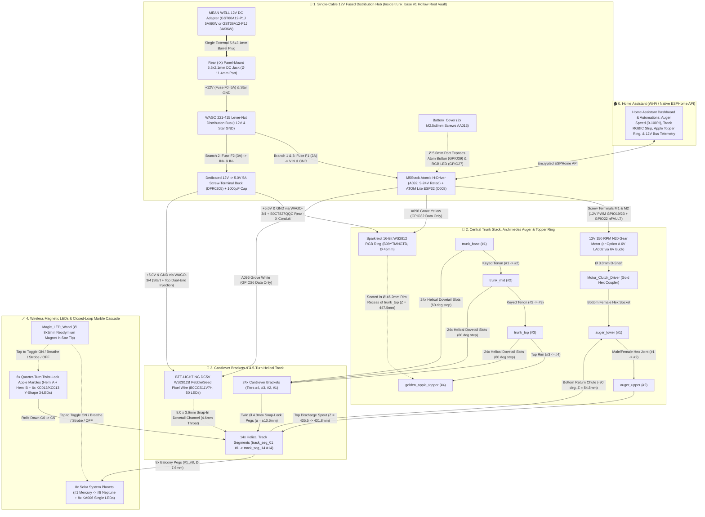
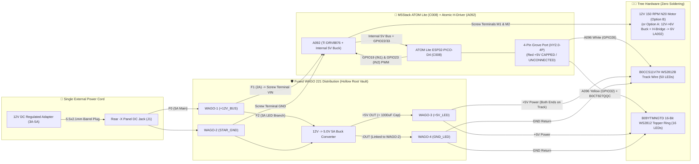

# 🍎🌲 Grav-Mass Day "Falling Apple Cascade" Marble Run Tree

[-crimson)](LICENSE)
[](LICENSE)

> **🌐 [Launch the Live 3D Simulator, Step-by-Step Assembly Studio & Plate Inspector (`newton.martinez.fyi`)](https://newton.martinez.fyi/)**

A motorized, closed-loop kinetic marble run sculpture (~527 mm tall × ~336 mm base diameter) celebrating Isaac Newton's **Grav-Mass Day** (December 25) and the Solar System. Engineered for 4-color multi-material 3D printing on the **Snapmaker U1** (`270 × 270 × 270 mm` build volume), this model lifts `Ø 25.0 mm` glowing crimson apple marbles up a two-stage internal Archimedes screw auger inside a bark-textured hollow tree trunk, discharges them beneath an illuminated sculpted Heart-Shaped Red Apple Topper, and cascades them down a `4.5`-turn conical emerald-green helical track past **8 multi-color, magnetically-lit Solar System planets**.

---

## ✨ Key Features

- **15 Single-Color Build Plates + 3 Dedicated 4-Color Build Plates (18 Plates Total — Zero OrcaSlicer Warnings!):** Pre-arranged for **Snapmaker OrcaSlicer** (`5 × 4` plate grid, `324.0 mm` stride, `<= 231.2 × 230.1 mm` centered footprint with `>= 19.6 mm` bed margin on all 4 sides). **Plates 1–15 are 100% single-color** (`enable_prime_tower=0`, zero filament swaps, spacious `>= 12.5 mm` part gaps, and **zero 2D Convex-Hull overlaps** in OrcaSlicer: `trunk_base` on Plate 1, upper trunk & covers on Plate 2, 12 brackets each on Plates 3 & 4, `track_seg_01..03` isolated solo on Plates 5–7, and side-by-side non-overlapping track pairs on Plates 8–13), while **Plates 16–18** group all multi-color parts (`golden_apple_topper` + `Magic_LED_Wand` on Plate 16, Warm/Gas-Giant planets on Plate 17, and Ocean/Ice-Giant planets on Plate 18) with **at most 4 colors per plate**.
- **One-Cable, 100% Solder-Free `12V` Power Architecture & ESPHome + Home Assistant Smart Control (`A092` + `C008`):** Powered by **one external UL-listed `12.0V DC` power adapter** (`MEAN WELL GST60A12-P1J` `12V 5A` or `GST36A12-P1J` `12V 3A`) entering a rear panel-mounted `5.5 × 2.1 mm` DC barrel jack and feeding **3 independently fused branches via WAGO `221` lever nuts**: (1) `12V → A092 (9–24V rated) → C008 ATOM Lite ESP32`, (2) `12V → Dedicated 5.0V 5A Screw-Terminal Buck Converter (DFR0205) → 50-LED Helical Track Wire (B0CCS11V7H on GPIO26) & 16-LED Apple Topper Ring (B09YTMNGTD on GPIO32)` (**isolated from `C008`'s `500 mA` USB diode!**), and (3) a **`12V 150 RPM N20` Auger Motor** on `A092` `M1/M2` (or Option A retrofit for the `6V` `LA002` motor via `12V→6V` buck + external H-bridge). See **[`POWER_ARCHITECTURE.md`](POWER_ARCHITECTURE.md)** for full schematics, power budget, fuse specs, and commissioning steps.
- **Wireless Glowing Marbles (`KC012`/`KC013`), Planets (`KA006`) & Addressable RGB Lantern Apple Topper (`B09YTMNGTD`):** Both [`golden_apple_topper`](cad/topper_planets.py) (`~2.2 mm` wall) and the 6 Quarter-Turn Twist-Lock Apple Marbles ([`Apple_Hemisphere_A`](cad/topper_planets.py) + [`B`](cad/topper_planets.py), `~1.9 mm` dome wall + `Ø 18.70 × 7.30 mm` chamber) feature **contoured, support-free hollow lantern interiors** with zero internal infill blocking the light. The Apple Topper is lit from below by a **`Ø 45 mm` 16-LED WS2812B Ring (`B09YTMNGTD`)** seated in the `Ø 46.2 mm` top rim recess of `trunk_top` (completely above the marble chute), each marble houses a **Bambu Lab Y-Shape 3-LED Magnetic Control Switch Light (`KC012`/`KC013`, `Ø 18 × 6.5 mm`)**, and each of the 8 Solar System planets houses a **Single LED Magnetic Control Switch Light (`KA006`, `Ø 7.5 × 6.0 mm`)**. Tap any planet or marble with the printable star-tipped **`Magic_LED_Wand`** (`Ø 8 × 2 mm` neodymium magnet in the tip) to cycle **Steady Glow → Breathe Pulse → Strobe Flash → OFF**.
- **Hidden Inner Assembly Numbering System:** Every trunk section (`1–4`), auger half (`1–2`), cantilever branch bracket (`1–4`), helical track segment (`1–14`), planet & track balcony peg (`1–8`), and marble hemisphere (`A` / `B`) has its assembly number debossed inside an internal or mating surface that becomes **100% invisible once assembled**.
- **Galileo–Newton Gravity Chronometer (`G0–G5` Timing Gates & Elevation Scales):** Molded directly into the outer track rails (`track_seg_01..14`) and front trunk viewing windows (`trunk_base..top`) are **6 Timing Gates (`G0`–`G5`)**, **`100 mm` (`10 cm`) true 3D spiral arc-length graduations**, **`25 mm` vertical drop ticks ($\Delta h$)**, and **`0.35 mm` acoustic click micro-ribs** (for $\pm 1\text{ ms}$ smartphone audio timing with **[Phyphox](https://phyphox.org/)**), paired with a live **Multi-Trial Gravity ($g$) Estimator** in the [3D Web App (`newton.martinez.fyi`)](https://newton.martinez.fyi/).

---

## 🛒 Complete Shopping List (Bill of Materials & Where to Buy)

Everything required to build, light, and control the tree in **Home Assistant (via ESPHome)** uses off-the-shelf components with **zero soldering** (only screw terminals and plug-in Grove/DuPont connectors). All legacy wired Bambu Lab hubs, switches, COB strips, and lamp pucks have been removed so you only buy what is used in the ESPHome model.

### 1. Electronics, Single-Cable 12V Power Distribution & Wireless Magnetic LEDs (100% Solder-Free)

> 📖 **Full Electrical Engineering Reference:** See **[`POWER_ARCHITECTURE.md`](POWER_ARCHITECTURE.md)** for the complete power budget, 3-branch fused wiring schematic, wire-gauge calculations, and multimeter commissioning checklist.

| Qty | Status / Role | Part Number / SKU | Component | Spec / Dimensions | Direct Product Link(s) | Where It Goes in the Tree |
| :---: | :---: | :---: | :--- | :--- | :--- | :--- |
| **1×** | **Required *(New — Single External Supply)*** | **`GST60A12-P1J`** *(or `GST36A12-P1J`)* | **MEAN WELL Regulated `12V DC` Desktop Power Adapter (`5.0A / 60W` or `3.0A / 36W`)** | `90–264V AC` in → Regulated `12.0V DC` out, `5.5 × 2.1 mm` center-positive plug, UL/cUL/TUV/CE/FCC Level VI | • [DigiKey / Mouser / Amazon — MEAN WELL `GST60A12-P1J` (`12V 5A 60W`)](https://www.amazon.com/s?k=MEAN+WELL+GST60A12-P1J) <br> • [Amazon — MEAN WELL `GST36A12-P1J` (`12V 3A 36W`)](https://www.amazon.com/s?k=MEAN+WELL+GST36A12-P1J) | Single external power cord plugging into the rear `-X` `5.5 × 2.1 mm` DC barrel jack on [`trunk_base`](cad/trunk.py) (`26.5W` max simultaneous peak load) |
| **1×** | **Required *(New — Panel DC Entry)*** | **`DC-099-18AWG`** *(or `B07C7VSRBG`)* | **Pre-Wired `5.5 × 2.1 mm` Threaded Panel-Mount DC Barrel Jack (`18 AWG` Leads)** | `12–24V DC`, `5A–10A` rated, `M11 × 0.75` (`Ø 11.0 mm`) thread with hex nut & pre-attached `18 AWG` red/black leads | [Amazon — 5.5 × 2.1 mm Threaded Panel-Mount DC Barrel Jack with Pre-Wired 18 AWG Leads (`B07C7VSRBG`)](https://www.amazon.com/dp/B07C7VSRBG) | Mounts into the **`Ø 11.4 mm` rear `-X` DC jack port** (`Z = 10.0 mm`) on [`trunk_base`](cad/trunk.py); pigtails route internally into the Hollow Root Vault |
| **1×** | **Required *(New — 5V LED Rail)*** | **`DFR0205`** *(or `B07V6X6L89`)* | **Regulated `12V → 5.0V 5A (25W)` Synchronous Buck Converter with Screw Terminals** | `7–25V DC` in → Fixed **`5.0V DC, 5.0A (25W)`** out (`88–92%` efficiency) with onboard `IN+/IN-/OUT+/OUT-` screw terminals | • [DFRobot / DigiKey — DC-DC Buck Converter `7-24V to 5V 5A` (`DFR0205`)](https://www.dfrobot.com/product-669.html) <br> • [Amazon — `12V to 5V 5A` Screw-Terminal Buck Converter (`B07V6X6L89`)](https://www.amazon.com/s?k=12V+to+5V+5A+buck+converter+screw+terminal) | Seats inside the `Ø 135 × 50 mm` Hollow Root Vault on Branch 2 (`F2 = 3A` fuse) to power all 66 WS2812B LEDs without loading `C008`'s USB diode |
| **1× Set** | **Required *(New — Solder-Free Bus & Fuses)*** | **`WAGO-221` + Inline Fuses** | **4× WAGO `221-415` / `221-413` Lever Nuts + 3× Pre-Wired Inline Blade Fuse Holders (`5A, 3A, 2A`) + `1000 µF 16V` Cap** | • `2× WAGO 221-415` (`+12V` & `Star GND`) + `2× WAGO 221-413` (`+5V LED` & `LED GND`) <br> • `18 AWG` inline mini blade fuse holders (`F0=5A`, `F1=2A`, `F2=3A`) <br> • `1× 1000 µF 16V` radial electrolytic capacitor | • [Amazon — WAGO `221` Lever-Nut Assortment (`221-413` / `221-415`)](https://www.amazon.com/s?k=WAGO+221-415) <br> • [Amazon — 18 AWG Inline Mini Blade Fuse Holders + Fuse Kit](https://www.amazon.com/s?k=18+AWG+inline+mini+blade+fuse+holder+kit) | Provides 100% tool-free, branch-fused `+12V`, `+5V`, and `Star GND` distribution inside the Hollow Root Vault (`1000 µF` cap clamps into Buck `OUT+/OUT-`) |
| **1×** | **Existing *(Retained)*** | **`A092`** | **M5Stack Atomic H-Bridge Driver Base (`DRV8876`)** | `48.0 × 24.0 × 18.0 mm`, **`9–24V DC` input**, TI `DRV8876` H-Bridge (`1.5A` cont / `2.0A` peak), internal `MP1584EN` `12V→5V` buck for `C008`, `HT3.96-4P` screw terminals (`M1`, `M2`, `VIN`, `GND`) | [M5Stack Store — Atomic H-Bridge Driver Base (`A092`)](https://shop.m5stack.com/products/atomic-h-bridge-driver-base-drv8876) | Seats into the stepped `-Y` bottom ESPHome bay (`49.2 × 25.2 × 20.3 mm`) of [`trunk_base`](cad/trunk.py); powered by **`12.0V DC`** on `VIN`/`GND` via Fuse `F1 (2A)` |
| **1×** | **Existing *(Retained)*** | **`C008`** | **M5Stack ATOM Lite ESP32 Development Kit** | `24.0 × 24.0 × 9.5 mm` `ESP32-PICO-D4` Wi-Fi/BLE controller with `HY2.0-4P` Grove port, `SK6812` RGB LED & button | [M5Stack Store — ATOM Lite ESP32 (`C008`)](https://shop.m5stack.com/products/atom-lite-esp32-development-kit) | Snaps onto `A092` (powered internally from `A092`'s `12V→5V` regulator; USB-C needed only for initial flashing of [`esphome/grav-mass-tree.yaml`](esphome/grav-mass-tree.yaml)) |
| **1×** | **Existing *(Retained)*** | **`A096`** | **M5Stack Grove2Dupont Conversion Cable (`20 cm, 5 Pairs`)** | Male `HY2.0-4P` Grove plug to 4× 2.54 mm DuPont pins (`Black=GND`, `White=G26`, `Yellow=G32`, `Red=+5V` capped/isolated) | [M5Stack Store — Grove2Dupont Conversion Cable (`A096`)](https://shop.m5stack.com/products/grove2dupont-conversion-cable-20cm-5pairs) | Plugs into `C008` Grove port to carry **`White = GPIO26` Track Data**, **`Yellow = GPIO32` Topper Data**, and **`Black = Signal GND`** (`Red +5V` is capped to prevent backfeeding!) |
| **1×** | **Recommended *(Option B — Replaces 6V `LA002`)*** | **`N20-12V-150RPM`** *(or Option A below)* | **`12V DC 150 RPM N20` Micro Metal Gear Motor (`Ø 3.0 mm` D-Shaft)** | `10 × 12 × 25 mm` metal gearbox (100% identical size to `LA002`), **`12.0V DC` rated**, `150 RPM`, `0.90 kg·cm` torque, `Ø 3.0 mm` D-shaft | [Amazon / Pololu — `12V DC 150 RPM N20` Micro Metal Gear Motor (`Ø 3mm` D-Shaft)](https://www.amazon.com/s?k=12V+150RPM+N20+gear+motor+D+shaft) | **Primary Option B:** Drops directly into [`trunk_base`](cad/trunk.py) & [`Servo_Or_030_Adapter`](cad/auger.py) and clamps straight into `A092` **`M1` & `M2`** (`12V` native PWM)! *(Or retain `6V LA002` via Option A in [`POWER_ARCHITECTURE.md`](POWER_ARCHITECTURE.md))* |
| **1×** | **Existing *(Retained)*** | **`B0CCS11V7H`** | **BTF-LIGHTING `DC5V` Addressable `WS2812B` RGB Pebble / Seed Pixel Flexible Wire (`16.4ft / 50 LEDs`, Track)** | `360°`-flexible 3-wire cord with `50×` `6.2 × 3.2 mm` oval epoxy RGB LED drops (`5V`, `5W` nominal / `9W` max white), 3-pin `JST-SM` + start/end power-injection leads | [Amazon — BTF-LIGHTING `DC5V` `WS2812B` Pebble/Seed Pixel Flexible Wire (`B0CCS11V7H`)](https://www.amazon.com/dp/B0CCS11V7H) | Snaps into the **`8.0 × 3.6 mm` dovetail channel (`4.6 mm` throat)** under [`track_seg_01`](cad/track.py)..[`14`](cad/track.py); powered from `5V` Buck (`WAGO-3/4`), Data from **`GPIO26` (White)** |
| **1×** | **Existing *(Retained)*** | **`B09YTMNGTD`** | **Sparkleiot 16-Bit WS2812 RGB LED Ring with `SM2.54-3P` Wire (Apple Topper)** | `Ø 45.0 mm` OD × `Ø 32.0 mm` ID addressable 16-LED 5V RGB ring (`4.8W` max white) with pre-wired 3-pin `JST-SM` (`SM2.54-3P`) plug | [Amazon — Sparkleiot 16-Bit WS2812 RGB LED Ring (`B09YTMNGTD`)](https://www.amazon.com/dp/B09YTMNGTD) | Seats flat in the **`Ø 46.2 × 2.5 mm` top rim recess** of [`trunk_top`](cad/trunk.py) (`Z = 447.5 mm`) inside [`golden_apple_topper`](cad/topper_planets.py); powered from `5V` Buck, Data from **`GPIO32` (Yellow)** |
| **1×** | **Existing *(Retained)*** | **`B0CT827QQC`** *(or `B0D14ZG75F`)* | **3-Pin `JST-SM` (`SM2.54-3P`) Male-to-Female Extension Cable (`1 m`)** | 3-pin `JST-SM` plug-and-play extension wire (`5V`, `GND`, `DATA`) | [Amazon — BTF-LIGHTING 3-Pin JST-SM Extension Cable (`B0CT827QQC`)](https://www.amazon.com/dp/B0CT827QQC) | Plugs into the Sparkleiot Topper Ring (`zero soldering`), threads down the **`10 × 8 mm` rear `-X` trunk conduit**, and connects to `WAGO-3/4` (`5V`/`GND`) + **`GPIO32` (Yellow)** |
| **6×** | **Existing *(Retained)*** | **`KC012`** *(White)* or **`KC013`** *(Warm White)* | **Bambu Lab Y-Shape LED Light with Magnetic Control Switch (6 Rolling Apple Marbles)** | `Ø 18.0 × 6.5 mm` 3-LED Y-board (`CR1632` battery + `Ø 8 × 2 mm` magnet included) | [Bambu Lab Store — Y-Shape LED Light with Magnetic Control Switch (`KC012` / `KC013`)](https://us.store.bambulab.com/products/y-shape-led-light-with-magnetic-control-switch) | **6×** drop into the **`Ø 18.70 × 7.30 mm`** equatorial chamber of the 6 Quarter-Turn Bayonet Twist-Lock Marbles (`Apple_Hemisphere_A` + `B`) |
| **8×** | **Existing *(Retained)*** | **`KA006`** | **Bambu Lab Single LED Magnetic Control Switch Light (8 Solar System Planets)** | `Ø 7.5 × 6.0 mm` single-LED (`CR927` battery + `Ø 8 × 2 mm` magnet included) | [Bambu Lab Store — Single LED Magnetic Control Switch Light (`KA006`)](https://us.store.bambulab.com/products/single-led-magnetic-control-switch-light) | **8×** press-fit into the `Ø 8.0 × 10.0 mm` bottom bores of the 8 Solar System planets (`planet_mercury..neptune`); **1×** magnet presses into [`Magic_LED_Wand`](cad/topper_planets.py) |
| *Optional* | *Optional Telemetry* | **`U190`** | **M5Stack Unit `INA226-10A` High-Precision Current/Voltage/Power Sensor** | `0–30V DC`, `±10A`, `HT3.96-4P` screw terminals + Grove `HY2.0-4P` I2C (`0x41`) | [M5Stack Store — Unit `INA226-10A` (`U190`)](https://shop.m5stack.com/products/ina226-voltage-and-current-measurement-unit-10a) | Clamps inline with the `5V` LED buck output (`GPIO21`/`GPIO25` I2C header) for real hardware current/power measurement in ESPHome |
| *Optional* | *Spare Cells* | **`CR1632`** & **`CR927`** | **Spare 3V Lithium Coin Cell Batteries** | • `CR1632` (`Ø 16 × 3.2 mm`) for `KC012`/`KC013` <br> • `CR927` (`Ø 9.5 × 2.7 mm`) for `KA006` | • [Amazon — CR1632 3V Lithium Coin Cells](https://www.amazon.com/s?k=CR1632+battery) <br> • [Amazon — Tenergy CR927 3V Lithium Button Cells (`B0CMCFGXSL`)](https://www.amazon.com/dp/B0CMCFGXSL) | Spare batteries for the 6 wireless marbles (`CR1632`) and 8 wireless planets (`CR927`) |

#### 🗺️ Complete Mechanical & Electrical Connection Diagram (One-Cable 12V Solder-Free Edition)



---

### 2. Fasteners (Only 2 Screws Needed!)

| Qty | Part Number / ASIN | Component | Spec / Dimensions | Direct Product Link(s) | Purpose |
| :---: | :---: | :--- | :--- | :--- | :--- |
| **2×** | **`AA013`** *(or `B0BYF4X65F`)* | **M2.5 × 6 mm Button Head Cap Machine Screws (BHCS)** | `M2.5 × 6 mm` stainless steel / alloy button head machine screws | • [Bambu Lab Store — M2.5 Button Head Cap Machine Screws BHCS (Select: `M2.5x6 - AA013`)](https://us.store.bambulab.com/products/m2-5-button-head-cap-machine-screws-bhcs) <br> • [Amazon — MonsterBolts M2.5 × 6mm Button Head Screws, 50-Pack (`B0BYF4X65F`)](https://www.amazon.com/dp/B0BYF4X65F) | Secures [`Battery_Cover`](output/Battery_Cover.stl) to the bottom of `trunk_base` |

---

### 3. 3D Printing Filament (Snapmaker U1 4-Toolhead Palettes — Max 4 Colors Per Plate)

| Toolhead / Role | Color & Finish | Material | Est. Weight | Spools Needed | Direct Product Link |
| :---: | :--- | :---: | :---: | :---: | :--- |
| **Core Tree `T1`** *(Plates 1, 2, 10, 11)* | **Matte Dark Wood Brown / Umber** (`#4A2F1D`) | PLA | ~1,150 g | **2× 1 kg spools** | [Bambu Lab Store — PLA Matte (Select: `Dark Brown 11801`)](https://us.store.bambulab.com/products/pla-matte) |
| **Core Tree `T2`** *(Plates 3–7, 10, 12)* | **Translucent Emerald Green / Teal** (`#00A86B`) | PETG | ~1,080 g | **2× 1 kg spools** | [Bambu Lab Store — PETG Translucent (Select: `Translucent Teal 32501`)](https://us.store.bambulab.com/products/petg-translucent) |
| **Core Tree `T3`** *(Plates 8, 10, 11, 12)* | **Silk Gold / Brass** (`#D4AF37`) | PLA | ~125 g | **1× 1 kg spool** | [Bambu Lab Store — PLA Silk+ (Select: `Gold 13405`)](https://us.store.bambulab.com/products/pla-silk-upgrade) |
| **Core Tree `T4`** *(Plates 9, 10, 11)* | **Glossy Crimson Red** (`#C41E3A`) | PLA | ~155 g | **1× 1 kg spool** | [Bambu Lab Store — PLA Basic (Select: `Red 10200`)](https://us.store.bambulab.com/products/pla-basic-filament) |
| **Planet Accent** *(Plate 11 `T2` & Plate 12 `T3`)* | **Ivory Alabaster / Polar Ice White** (`#F5EFE6` / `#F0F4F8`) | PLA | ~35 g | **1× spool** *(any White/Ivory PLA)* | [Bambu Lab Store — PLA Matte (Select: `Ivory White 11100`)](https://us.store.bambulab.com/products/pla-matte) |
| **Ocean/Ice Planet Accent** *(Plate 12 `T1`)* | **Deep Cobalt / Azure Ocean Blue** (`#1E5AA8`) | PLA | ~30 g | **1× spool** *(any Cobalt/Marine Blue PLA)* | [Bambu Lab Store — PLA Matte (Select: `Marine Blue 11600`)](https://us.store.bambulab.com/products/pla-matte) |

---

## 🖨️ 3D Printing & Support Guide (18 Pre-Arranged `.3mf` Build Plates — Snapmaker U1 `0.4 mm` Nozzle, Zero Collisions, Max 4 Colors Per Plate)

All ready-to-print `.3mf` files are located in [`output/3mf/`](output/3mf/), pre-configured for the **Snapmaker U1 with a `0.4 mm` nozzle** (`printer_settings_id = "Snapmaker U1 (0.4 nozzle)"`, `nozzle_diameter = ["0.4", "0.4", "0.4", "0.4"]`, `0.20 mm` standard layer height), and use Snapmaker OrcaSlicer's native `5 × 4` multi-plate grid (`324.0 mm` X/Y plate stride centered at `+135.0 mm`) with unified multi-part objects (`<components>` + `<part subtype="normal_part">`). **Every plate contains only the needed parts (including multiple copies of parts used multiple times, such as 3× `Conduit_Cover_Strip`, 24× `bracket_01..24`, and 12× `apple_hemisphere_a/b_01..06`), uses at most 4 colors (4 toolheads), fits comfortably inside a `231 × 231 mm` centered zone (`>= 19.6 mm` bed margin on all 4 sides), has zero 2D Convex-Hull / AABB overlaps (`>= 12.5 mm` part clearance), and Plates 1–15 are 100% single-color plates with `enable_prime_tower = 0`!**

- **All-in-One 18-Plate Project File:** [`output/3mf/GravMass_Tree_Ultimate_U1.3mf`](output/3mf/GravMass_Tree_Ultimate_U1.3mf)
- **Full 3D Reference Assembly:** [`output/3mf/GravMass_Tree_Complete_Assembly.3mf`](output/3mf/GravMass_Tree_Complete_Assembly.3mf)

### Plate-by-Plate Breakdown & Support Settings

| Plate | `.3mf` File | Toolhead(s) & Palette (`<= 4` Colors) | Color Mode | Supports Needed? | Recommended OrcaSlicer Settings | Parts on Plate |
| :---: | :--- | :---: | :---: | :---: | :--- | :--- |
| **Plate 1** | [`Plate_1_SingleColor_Brown_Trunk_Base.3mf`](output/3mf/Plate_1_SingleColor_Brown_Trunk_Base.3mf) | **`T1` Only** (`#4A2F1D` Brown PLA) | **Single-Color** *(0 swaps, 0 prime tower)* | **No (`100% Support-Free`)** | `0.20 mm` layer, 3 walls, 15% Gyroid, **Supports: OFF** | `trunk_base` (`#1`), `Base_Bottom_Cover` (2 objects, `204.9 × 144.5 mm`, `15.1 mm` gap) |
| **Plate 2** | [`Plate_2_SingleColor_Brown_Trunk_Upper_And_Covers.3mf`](output/3mf/Plate_2_SingleColor_Brown_Trunk_Upper_And_Covers.3mf) | **`T1` Only** (`#4A2F1D` Brown PLA) | **Single-Color** *(0 swaps, 0 prime tower)* | **No (`100% Support-Free`)** | `0.20 mm` layer, 3 walls, 15% Gyroid, **Supports: OFF** | `trunk_mid` (`#2`), `trunk_top` (`#3`), `Battery_Cover`, `3× Conduit_Cover_Strip` (`_01..03` for the 3 trunk sections), `Servo_Or_030_Adapter` (7 objects, `16.2 mm` gap) |
| **Plate 3** | [`Plate_3_SingleColor_Brown_Brackets_01_To_12.3mf`](output/3mf/Plate_3_SingleColor_Brown_Brackets_01_To_12.3mf) | **`T1` Only** (`#4A2F1D` Brown PLA) | **Single-Color** *(0 swaps, 0 prime tower)* | **No (`100% Support-Free`)** | `0.20 mm` layer, 3 walls, 15% Gyroid, **Supports: OFF** *(upright on flat `Z = 0` lower rib)* | `bracket_01` through `bracket_12` (12 exact-radius station brackets, `14.6 mm` gap) |
| **Plate 4** | [`Plate_4_SingleColor_Brown_Brackets_13_To_24.3mf`](output/3mf/Plate_4_SingleColor_Brown_Brackets_13_To_24.3mf) | **`T1` Only** (`#4A2F1D` Brown PLA) | **Single-Color** *(0 swaps, 0 prime tower)* | **No (`100% Support-Free`)** | `0.20 mm` layer, 3 walls, 15% Gyroid, **Supports: OFF** *(upright on flat `Z = 0` lower rib)* | `bracket_13` through `bracket_24` (12 exact-radius station brackets, `14.6 mm` gap) |
| **Plate 5** | [`Plate_5_SingleColor_Green_Track_01.3mf`](output/3mf/Plate_5_SingleColor_Green_Track_01.3mf) | **`T2` Only** (`#00A86B` Green PETG) | **Single-Color** *(0 swaps, 0 prime tower)* | **Minimal (`~2–5 mm` under mid-arch)** | `0.20 mm` layer, 3 walls, 15% Gyroid, **Supports: ON (`Tree (auto)` + `On build plate only` + `Don't support bridges`)** | Dedicated solo `track_seg_01` (`230.8 × 230.1 × 47.8 mm`, `Z_min = 0.000 mm`, `>= 19.6 mm` margin to all 4 bed edges) |
| **Plate 6** | [`Plate_6_SingleColor_Green_Track_02.3mf`](output/3mf/Plate_6_SingleColor_Green_Track_02.3mf) | **`T2` Only** (`#00A86B` Green PETG) | **Single-Color** *(0 swaps, 0 prime tower)* | **Minimal (`~2–5 mm` under mid-arch)** | `0.20 mm` layer, 3 walls, 15% Gyroid, **Supports: ON (`Tree (auto)` + `On build plate only` + `Don't support bridges`)** | Dedicated solo `track_seg_02` (`203.4 × 202.2 × 32.7 mm`) |
| **Plate 7** | [`Plate_7_SingleColor_Green_Track_03.3mf`](output/3mf/Plate_7_SingleColor_Green_Track_03.3mf) | **`T2` Only** (`#00A86B` Green PETG) | **Single-Color** *(0 swaps, 0 prime tower)* | **Minimal (`~2–5 mm` under mid-arch)** | `0.20 mm` layer, 3 walls, 15% Gyroid, **Supports: ON (`Tree (auto)` + `On build plate only` + `Don't support bridges`)** | Dedicated solo `track_seg_03` (`195.6 × 194.4 × 34.9 mm`) |
| **Plate 8** | [`Plate_8_SingleColor_Green_Track_04.3mf`](output/3mf/Plate_8_SingleColor_Green_Track_04.3mf) | **`T2` Only** (`#00A86B` Green PETG) | **Single-Color** *(0 swaps, 0 prime tower)* | **Minimal (`~2–5 mm` under mid-arch)** | `0.20 mm` layer, 3 walls, 15% Gyroid, **Supports: ON (`Tree (auto)` + `On build plate only` + `Don't support bridges`)** | Dedicated solo `track_seg_04` (`187.8 × 186.6 × 33.4 mm`) |
| **Plate 9** | [`Plate_9_SingleColor_Green_Track_05_And_13.3mf`](output/3mf/Plate_9_SingleColor_Green_Track_05_And_13.3mf) | **`T2` Only** (`#00A86B` Green PETG) | **Single-Color** *(0 swaps, 0 prime tower)* | **Minimal (`~2–5 mm` under mid-arch)** | `0.20 mm` layer, 3 walls, 15% Gyroid, **Supports: ON (`Tree (auto)` + `On build plate only` + `Don't support bridges`)** | Side-by-side `track_seg_05` + `track_seg_13` (2 objects, zero convex-hull overlap) |
| **Plate 10** | [`Plate_10_SingleColor_Green_Track_06_And_12.3mf`](output/3mf/Plate_10_SingleColor_Green_Track_06_And_12.3mf) | **`T2` Only** (`#00A86B` Green PETG) | **Single-Color** *(0 swaps, 0 prime tower)* | **Minimal (`~2–5 mm` under mid-arch)** | `0.20 mm` layer, 3 walls, 15% Gyroid, **Supports: ON (`Tree (auto)` + `On build plate only` + `Don't support bridges`)** | Side-by-side `track_seg_06` + `track_seg_12` (2 objects, zero convex-hull overlap) |
| **Plate 11** | [`Plate_11_SingleColor_Green_Track_07_And_11.3mf`](output/3mf/Plate_11_SingleColor_Green_Track_07_And_11.3mf) | **`T2` Only** (`#00A86B` Green PETG) | **Single-Color** *(0 swaps, 0 prime tower)* | **Minimal (`~2–5 mm` under mid-arch)** | `0.20 mm` layer, 3 walls, 15% Gyroid, **Supports: ON (`Tree (auto)` + `On build plate only` + `Don't support bridges`)** | Side-by-side `track_seg_07` + `track_seg_11` (2 objects, zero convex-hull overlap) |
| **Plate 12** | [`Plate_12_SingleColor_Green_Track_08_And_10.3mf`](output/3mf/Plate_12_SingleColor_Green_Track_08_And_10.3mf) | **`T2` Only** (`#00A86B` Green PETG) | **Single-Color** *(0 swaps, 0 prime tower)* | **Minimal (`~2–5 mm` under mid-arch)** | `0.20 mm` layer, 3 walls, 15% Gyroid, **Supports: ON (`Tree (auto)` + `On build plate only` + `Don't support bridges`)** | Side-by-side `track_seg_08` + `track_seg_10` (2 objects, zero convex-hull overlap) |
| **Plate 13** | [`Plate_13_SingleColor_Green_Track_09_And_14.3mf`](output/3mf/Plate_13_SingleColor_Green_Track_09_And_14.3mf) | **`T2` Only** (`#00A86B` Green PETG) | **Single-Color** *(0 swaps, 0 prime tower)* | **Minimal (`~2–5 mm` under mid-arch)** | `0.20 mm` layer, 3 walls, 15% Gyroid, **Supports: ON (`Tree (auto)` + `On build plate only` + `Don't support bridges`)** | Side-by-side `track_seg_09` + `track_seg_14_top_entry` (2 objects, zero convex-hull overlap) |
| **Plate 14** | [`Plate_14_SingleColor_Gold_Auger_And_Drive.3mf`](output/3mf/Plate_14_SingleColor_Gold_Auger_And_Drive.3mf) | **`T3` Only** (`#D4AF37` Silk Gold PLA) | **Single-Color** *(0 swaps, 0 prime tower)* | **No (`100% Support-Free`)** | `0.20 mm` layer, 3 walls, 15% Gyroid, **Supports: OFF** | `auger_lower`, `auger_upper`, `Motor_Clutch_Driver` (3 objects, `22.0 mm` gap) |
| **Plate 15** | [`Plate_15_SingleColor_Red_Apple_Marbles.3mf`](output/3mf/Plate_15_SingleColor_Red_Apple_Marbles.3mf) | **`T4` Only** (`#C41E3A` Red PLA) | **Single-Color** *(0 swaps, 0 prime tower)* | **No (`100% Support-Free`)** | `0.16–0.20 mm` layer, **2 walls**, 10% Gyroid, **Supports: OFF** | `6× Apple_Hemisphere_A` (`_01..06`) + `6× Apple_Hemisphere_B` (`_01..06`) = 6 complete twist-lock marbles (12 objects, `16.0 mm` gap) |
| **Plate 16** | [`Plate_16_MultiColor_Topper_And_Wand.3mf`](output/3mf/Plate_16_MultiColor_Topper_And_Wand.3mf) | **4 Colors (Tree Palette):** `T1 #4A2F1D` Brown, `T2 #00A86B` Green, `T3 #D4AF37` Gold, `T4 #C41E3A` Red | **4-Color** *(Unified Objects)* | **Minimal** *(under Apple Leaf)* | `0.16–0.20 mm` layer, **2 walls**, 10% Gyroid, **Supports: ON (`Tree (auto)` + `On build plate only`)** | `golden_apple_topper` (unified Red Shell + Brown Stem + Green Leaf + Trunk Collar), `Magic_LED_Wand` (2 unified objects, `25.0 mm` gap) |
| **Plate 17** | [`Plate_17_MultiColor_Planets_Warm_And_Gas_Giants.3mf`](output/3mf/Plate_17_MultiColor_Planets_Warm_And_Gas_Giants.3mf) | **4 Colors (Warm Palette):** `T1 #4A2F1D` Umber, `T2 #F5EFE6` Alabaster White, `T3 #D4AF37` Gold, `T4 #C41E3A` Crimson | **4-Color** *(Unified Objects)* | **Minimal** *(under Saturn ring)* | `0.16 mm` layer, **2 walls**, 12% Gyroid, **Supports: ON (`Tree (auto)` + `On build plate only`)** *(45° Orbital Pedestal Foot Collar makes globes self-supporting!)* | **5 Larger 4-Color Sculpted Planets:** `planet_mercury` (`Ø 23.3 mm`), `planet_venus` (`Ø 26.5 mm`), `planet_mars` (`Ø 28.2 mm`), `planet_jupiter` (`Ø 36.1 mm`), `planet_saturn` (`Ø 44.0 mm` ring span) |
| **Plate 18** | [`Plate_18_MultiColor_Planets_Ocean_And_Ice_Giants.3mf`](output/3mf/Plate_18_MultiColor_Planets_Ocean_And_Ice_Giants.3mf) | **4 Colors (Ocean/Ice Palette):** `T1 #1E5AA8` Cobalt Blue, `T2 #00A86B` Emerald/Teal, `T3 #F0F4F8` Ice White, `T4 #D4AF37` Gold | **4-Color** *(Unified Objects)* | **Minimal** *(under Uranus tilted ring)* | `0.16 mm` layer, **2 walls**, 12% Gyroid, **Supports: ON (`Tree (auto)` + `On build plate only`)** | **3 Larger 4-Color Sculpted Planets:** `planet_earth` (`Ø 28.6 mm`), `planet_uranus` (`Ø 36.4 mm` ring span), `planet_neptune` (`Ø 29.0 mm`) |

> **💡 Pitch-Leveled Horizontal Track Orientation (`Option A`) + `"On build plate only"`:**  
> Every helical track segment (`track_seg_01`..`14`) is **pitch-tilted by its helical chord angle (`~6.4°–12.9°`)** so **both its downhill end and uphill end rest flat on the build plate (`Z = 0.0`)**—dropping segment print height from `55.3 mm` down to `~35.0 mm` and cutting mid-span support height by **`> 70%`** (to just a shallow `~2–5 mm` arch in the middle) while running filament extrusions smoothly along the marble rolling path! Enabling **"On build plate only"** and **"Don't support bridges"** keeps the `45°` underside LED dovetail channel, snap-lock sockets, and bracket peg holes 100% clean and free of support material.

---

## 🔧 Step-by-Step Physical Assembly Instructions

> **💡 Interactive 3D Tutorial:** You can follow every connection piece-by-piece in 3D using the **[Live 3D Assembly Studio (`newton.martinez.fyi`)](https://newton.martinez.fyi/)** (`Step-by-Step Assembly & Exploded View` tab → `⏮ Prev Piece` / `Next Piece ⏭`).

### 🔢 Hidden Inner Assembly Numbering System (Zero Visible Marks When Assembled!)
Every multi-piece subsystem has its **assembly order number debossed into an internal/mating surface** so you can identify every part at a glance during assembly, while **100% of the numbers are hidden inside joints, sockets, or bores once assembled**:

| Subsystem | Engraved Mark | Where to Find It (Before Assembly) | How It Hides (Once Assembled) |
| :--- | :---: | :--- | :--- |
| **Apple Marble Hemispheres** | **`A`**, **`B`** | Inside the hollow central core ceiling (`Z = 10.6 mm`) of `Apple_Hemisphere_A` and `Apple_Hemisphere_B` | Sealed inside the `Ø 25.0 mm` sphere once `A` and `B` snap together |
| **Archimedes Auger Halves** | **`1`**, **`2`** | **`1`** on the flat top of `auger_lower`'s male hex peg (`Z = 208 mm`); **`2`** on the flat top of `auger_upper`'s shaft (`Z = 198 mm`) | **`1`** hides inside `auger_upper`'s bottom hex socket; **`2`** hides deep inside the top of `trunk_top` |
| **Bark-Textured Trunk & Topper Stack** | **`1` → `2` → `3` → `4`** | **`1`** on top tenon rim of `trunk_base`; **`2`** on top tenon rim of `trunk_mid`; **`3`** on top Crown Centering Tenon Collar of `trunk_top`; **`4`** inside the lantern ceiling of `golden_apple_topper` | Each number is covered by the female socket of the section stacked directly on top of it |
| **Cantilever Branch Brackets** | **`1` – `4`** *(Digit + Bars)* | Arabic digit **`1`**, **`2`**, **`3`**, or **`4`** in the recessed top saddle between the two `Ø 4.0 mm` pegs **plus** `1`–`4` horizontal V-notch bars on the `-X` dovetail back face | Top digit is covered by the underside of the track segment; dovetail bars hide inside the trunk slot |
| **Helical Track Segments** | **`1` – `14`** | Engraved on the `15°` **scarf-joint mating end face(s)** beside the **Twin `Ø 3.80 mm` Male Snap-Lock Tenon Pegs / `Ø 4.30 mm` Female Sockets** (`track_seg_01` = `1` at bottom → `track_seg_14_top_entry` = `14` at top) | Pressed face-to-face against the adjacent track segment inside the snap-locked scarf joint |
| **Solar System Planets & Balcony Pegs** | **`1` – `8`** *(Top to Bottom)* | **`1`** (Mercury) to **`8`** (Neptune) engraved inside the top ceiling of each planet's bottom LED bore **and** on the flat top of the matching `Ø 7.60 mm` track balcony peg | Hidden inside the planet's bottom bore once the planet is pushed onto its matching balcony peg (`1`→`1` .. `8`→`8`) |

---

### Step 1: Assemble the 6 Glowing Rolling Apple Marbles (`A` + `B` Quarter-Turn Bayonet Twist-Lock)
1. Take the 6 pairs of [`Apple_Hemisphere_A`](output/Apple_Hemisphere_A.stl) (marked **`A`** inside the central cavity, featuring the **3-lug male bayonet collar** `R_neck = 10.30 mm` / `R_lug = 11.15 mm` with a `45°` elephant's-foot relief chamfer) and [`Apple_Hemisphere_B`](output/Apple_Hemisphere_B.stl) (marked **`B`** inside the central cavity, featuring the **3 wide vertical entry keyway slots and clockwise undercut locking tunnels**).
2. **Insert the Y-Shape 3-LED Light (`KC012` / `KC013`):**
   - Drop a **`Ø 18.0 × 6.5 mm` [Bambu Lab Y-Shape LED Light with Magnetic Control Switch (`KC012` / `KC013`)](https://us.store.bambulab.com/products/y-shape-led-light-with-magnetic-control-switch)** directly into the **`Ø 18.70 × 7.30 mm`** equatorial chamber of `Apple_Hemisphere_B`. Its 3 Y-spaced LEDs illuminate the entire thin-shell hollow marble, while its steel `CR1632` battery provides centered rolling momentum (no extra weights or nuts needed).
3. **Drop In & Quarter-Turn Twist to Lock:** Align the **3 male bayonet lugs** on `Apple_Hemisphere_A` with the **3 open vertical keyway slots** on `Apple_Hemisphere_B`—the two halves drop flush together with **zero force** (`+0.44 mm` clearance, no bending rigid PLA required). Then **twist `Apple_Hemisphere_A` `45°` clockwise ("righty-tighty")** to lock the 3 lugs underneath the solid retaining ceiling so the halves cannot separate during rolling or drops. Repeat for all 6 marbles.

### Step 2: Install the N20 Motor, Rear 12V DC Barrel Jack (`J1`), 5V Buck Converter & M5Stack ESPHome Controller (`A092` + `C008`) in `trunk_base` (`#1`)
1. Turn [`trunk_base`](output/trunk_base.stl) (marked **`1`** on its top tenon rim; `Ø 185.0 mm` diagonal root footprint with a cavernous **`Ø 135.0 × 50.0 mm` Hollow Root Vault** providing **`> 150,000 mm³` (`150+ cm³`)** of open cable slack space) upside down to access the bottom vault.
2. **Mount the Rear `-X` `12V` DC Barrel Jack (`J1`):**
   - Thread the pre-wired **`5.5 × 2.1 mm` Female Panel-Mount DC Barrel Jack (`DC-099`, `M11 × 0.75`)** through the rear `-X` **`Ø 11.40 mm` port** (`Z = 10.0 mm`) on `trunk_base` and tighten its hex nut. Route its `18 AWG` pigtails into the vault through `dc_jack_vault_portal` to `WAGO-1 (+12V_BUS)` (via inline `5A` fuse `F0`) and `WAGO-2 (STAR_GND)`.
3. **Slide the N20 Gear Motor Into the Central Shroud Tower:**
   - Slide the **`12V DC 150 RPM N20` Micro Metal Gear Motor** (Option B primary drop-in; or existing `6V LA002` motor if building Option A) + [`Servo_Or_030_Adapter`](output/Servo_Or_030_Adapter.stl) upward into the central **`Ø 28.0 mm` Isolated Motor & Clutch Shroud Tower** so its `Ø 3.0 mm` D-shaft protrudes upward through the `Z = 36 mm` ceiling into the auger bore, and route its 2-wire lead out the bottom `-Y` shroud wire exit notch (`6.5 × 7.6 mm`). Because the `Ø 28.0 mm` shroud completely encloses the motor and `Ø 20.0 mm` safety clutch/coupler, loose cables in the vault can **never** rub against spinning parts.
4. **Drop Boards into Dedicated Snap-In Cradles (Spaced `>= 18.0 mm` Apart for Finger Access):**
   - **Branch 1 & 3 — M5Stack Controller & Motor Driver (`A092` + `C008`):** Snap the **M5Stack ATOM Lite ESP32 (`C008`, `24.0 × 24.0 × 10.0 mm`)** onto the **Atomic H-Bridge Driver Base (`A092`, `48.0 × 24.0 × 18.0 mm`)** and seat into the `-Y` cradle (`(0, -33.0 mm)`). Connect `WAGO-1 (+12V_BUS)` (via `2A` inline fuse `F1`) and `WAGO-2 (STAR_GND)` to `A092` **`VIN`** and **`GND`** screw terminals (`A092`'s internal `MP1584EN` buck regulator automatically powers `C008` from `12V`—no USB-C cable needed!).
   - **Branch 2 — Dedicated `12V → 5.0V 5A` LED Buck Converter:** Seat the pre-assembled screw-terminal **`12V → 5.0V 5A` Synchronous Buck Converter** into the `+X` vault cradle (`(+40.0, -14.0 mm)`), fed from `WAGO-1 (+12V_BUS)` via `3A` inline fuse `F2` and `WAGO-2 (STAR_GND)`. Connect its `+5V OUT` and `-OUT` screw terminals (plus a `1000 µF 16V` bulk capacitor) to **`WAGO-3 (+5V_LED)`** and **`WAGO-4 (GND_LED)`** (linked to `WAGO-2` Star Ground).
5. **Zero-Fuss Solder-Free Terminal Clamping & Cable Stuffing:**
   - Clamp the **`12V 150 RPM N20` Motor** leads into the **`M1` & `M2` screw terminals** on `A092` (or follow [Section 5.2 of `POWER_ARCHITECTURE.md`](POWER_ARCHITECTURE.md) if using Option A with the `6V LA002` motor).
   - Plug the `200 mm` **M5Stack Grove2Dupont Cable (`A096`)** into `C008`'s `HY2.0-4P` Grove port. **IMPORTANT (`5V` Rail Isolation):** Leave the `A096` **`Red (+5V)` wire UNCONNECTED (cap inside an empty WAGO lever slot)** so the external `5V` LED buck converter never backfeeds `A092`'s internal `5V` regulator! Connect `A096` `Black (GND)` to `WAGO-2` (`STAR_GND`).
   - Secure [`Battery_Cover`](output/Battery_Cover.stl) (`2× M2.5 × 6 mm` screws `AA013`) and snap [`Base_Bottom_Cover`](output/Base_Bottom_Cover.stl) (`3.0 mm` thick service lid with ventilation louvers, 4× captive-magnet tabs, and an upward **`Ø 23.60 × 2.8 mm` Snap-In Hollow Retaining Ring** that clicks concentrically into `trunk_base`'s central `Ø 24.00 mm` bottom shroud bore with zero screws needed) onto the bottom access port.
6. From inside the top of `trunk_base`, press [`Motor_Clutch_Driver`](output/Motor_Clutch_Driver.stl) (gold hex driver) down onto the N20 motor's D-shaft.

### Step 3: Couple & Insert the Two-Stage Archimedes Screw Auger (`#1` + `#2`)
1. Identify [`auger_lower`](output/auger_lower.stl) (engraved with **`1`** on the flat top of its male hex peg) and [`auger_upper`](output/auger_upper.stl) (engraved with **`2`** on the flat top of its central shaft).
2. Slide the hexagonal male peg (`#1`) at the top of `auger_lower` into the matching female hexagonal socket in the bottom of `auger_upper` (`#2`), hiding the **`1`** inside the joint and aligning the helical screw flights into one continuous spiral.
3. Lower the assembled auger into `trunk_base` so the bottom female hex socket of `auger_lower` engages the hex head of `Motor_Clutch_Driver`. Spin the auger by hand slightly to verify smooth seating.

### Step 4: Stack the Bark-Textured Trunk Sections (`#1` → `#2` → `#3`)
1. Take [`trunk_mid`](output/trunk_mid.stl) (engraved with **`2`** on its top tenon rim) and lower its bottom keyed female socket onto the top male tenon (`#1`) of `trunk_base`, hiding the **`1`** inside the joint (`15 mm` overlap).
2. Take [`trunk_top`](output/trunk_top.stl) (engraved with **`3`** on its top Crown Centering Tenon Collar) and stack it onto `trunk_mid`'s top tenon (`#2`), hiding the **`2`** inside the joint.
3. Confirm that the organic vertical **bark ridges**, internal `-Y` ball flute, **gothic-arched front viewing windows**, and the oversized **`10.0 mm wide × 8.0 mm deep` rear `-X` Connector-Pass-Through wiring conduit** align seamlessly from bottom to top.

### Step 5: Slide in All 24 Exact-Radius Cantilever Branch Brackets (Sorted by Engraved `1–24` Numbers)
1. **Plates 3 & 4** ([`Plate_3_SingleColor_Brown_Brackets_01_To_12.3mf`](output/3mf/Plate_3_SingleColor_Brown_Brackets_01_To_12.3mf) and [`Plate_4_SingleColor_Brown_Brackets_13_To_24.3mf`](output/3mf/Plate_4_SingleColor_Brown_Brackets_13_To_24.3mf)) print all **24 exact-radius station brackets** ([`bracket_01`](output/bracket_01.stl) through [`bracket_24`](output/bracket_24.stl)) upright on `Z = 0` with zero supports. Each bracket has its exact station number (**`1` through `24`**) engraved face-up in the recessed top saddle between the two `Ø 4.0 mm` pegs **and** `1–4` horizontal tier bars on the back of its dovetail tenon (both hide completely once assembled):
   - **Lower 6 Stations (`1` to `6`, Tier 4, on Plate 3):** Slide [`bracket_01`](output/bracket_01.stl)..[`bracket_06`](output/bracket_06.stl) downward in ascending spiral order into the lowest 6 trunk dovetail slots (`theta = 60°..360°`, radii `141.9 mm` down to `126.1 mm`).
   - **Lower-Mid 6 Stations (`7` to `12`, Tier 3, on Plate 3):** Slide [`bracket_07`](output/bracket_07.stl)..[`bracket_12`](output/bracket_12.stl) into the next 6 slots (`theta = 420°..720°`, radii `123.0 mm` down to `107.2 mm`, including the precision cross-seam dovetails at `Z = 150 mm`).
   - **Upper-Mid 6 Stations (`13` to `18`, Tier 2, on Plate 4):** Slide [`bracket_13`](output/bracket_13.stl)..[`bracket_18`](output/bracket_18.stl) into the next 6 slots (`theta = 780°..1080°`, radii `104.1 mm` down to `88.3 mm`).
   - **Upper 6 Stations (`19` to `24`, Tier 1, on Plate 4):** Slide [`bracket_19`](output/bracket_19.stl)..[`bracket_24`](output/bracket_24.stl) into the upper 6 slots (`theta = 1140°..1440°`, radii `85.2 mm` down to `69.4 mm`, including the cross-seam dovetails at `Z = 300 mm`).

### Step 6: Snap Together the Helical Track Segments (`1` to `14`) via the Built-In Male/Female Snap-Lock Joint + Seam Brackets
1. Check the angled `15°` scarf-joint mating end faces of each green track segment—each segment is engraved with its sequence number **`1` through `14`** and features an **Integrated 4-Point Male-to-Female Snap-Lock Interlock + Underside Seam Bracket Sockets**:
   - **Uphill Face (`theta_end_deg` of Segments `1`–`13`):** Protrudes **Twin `Ø 3.80 × 5.0 mm` Under-Shoulder Male Snap-Lock Tenon Pegs** (with `Ø 4.08 mm` annular snap-detent rings and `45°` nose chamfers at `u = ±14.2 mm, v = -4.2 mm`) **PLUS Inner & Outer Sidewall Anti-Torsion Tongue Tabs** (`u = -18.5 mm` and `u = +18.8 mm`).
   - **Downhill Face (`theta_start_deg` of Segments `2`–`14`):** Features **Matching `Ø 4.30 × 5.6 mm` Female Snap-Lock Sockets** (with entry flare and `Ø 4.60 mm` internal snap-detent groove) **PLUS Matching Sidewall Anti-Torsion Slots**.
   - **Underside Seam Bracket Sockets (`120°, 240°, 360°, ..., 1560°`):** In addition to the midpoint bracket sockets (`60°, 180°, 300°, ...`), every segment end also includes underside `Ø 4.40 mm` vertical sockets at `u = ±10.6 mm` so the even-`60°` cantilever brackets lock directly under the segment seams!
2. Start at the bottom with **Segment `1`** ([`track_seg_01`](output/track_seg_01.stl)):
   - Dock its inward spiral return chute (`-90°`) flush against the `-Y` bottom intake port of `trunk_base` (`Z = 50..57 mm`) and press its underside sockets onto the twin snap-lock pegs of the Tier `4` brackets at `60°` and `120°` (covering the **`1`** and **`2`** digits on the brackets!).
3. Continue upward in numerical order from **Segment `2`** ([`track_seg_02`](output/track_seg_02.stl)) through **Segment `13`** ([`track_seg_13`](output/track_seg_13.stl)):
   - Slide each segment's downhill **Female Sockets** directly onto the previous segment's uphill **Twin Male Snap-Lock Tenon Pegs + Sidewall Tongues** (`1` into `2`, `2` into `3`, ..., `12` into `13`) until the detent rings click flush along the `15°` downhill scarf joint, while clicking the underside sockets onto the bracket pegs below.
4. Finish the track at the top with **Segment `14`** ([`track_seg_14_top_entry`](output/track_seg_14_top_entry.stl)):
   - Click its downhill Female Sockets (`14`) onto Segment `13`'s Male Snap-Tenons and dock its upper catch basin (`1710°`) flush against the `-Y` upper discharge spout of `trunk_top` (`Z = 425..435 mm`).
5. **Snap In the Full-Length Under-Track BTF-LIGHTING `DC5V` `WS2812B` Pebble/Seed Pixel Flexible Wire (`B0CCS11V7H`, Segment `1` → Segment `14`):**
   - Seat the starter end of the **[BTF-LIGHTING `DC5V` `WS2812B` Pebble/Seed Pixel Flexible Wire (`16.4ft / 50 LEDs`, `B0CCS11V7H`)](https://www.amazon.com/dp/B0CCS11V7H)** into the **`10.0 × 16.0 × 3.7 mm` starter feed pocket** on the underside of `track_seg_01` (right outside the `-Y` trunk intake port at `-70°`).
   - Press the `360°`-flexible 3-wire cord (`~3.4 × 1.4 mm`) and `50×` oval epoxy Pebble LEDs (`~6.2 × 3.2 mm`) upward through the **`4.6 mm` snap-in throat** into the **`8.0 × 3.6 mm` internal dovetail chamber** all the way up the `4.5`-turn spiral from `track_seg_01` to `track_seg_14_top_entry`. Because each `6.2 mm` wide oval pebble LED slips through the `4.6 mm` throat on an angle and lays flat inside the `8.0 mm` chamber above the twin `45°` retention lips, **the entire wire locks in mechanically with zero glue and zero tape!**
   - Feed the wire's 3-pin `JST-SM` input lead (and both red/black power-injection leads) through the **`cob_wire_entry_port`** (`7.5 × 12.0 × 6.5 mm` at `X = +16.5, Y = -31.5, Z = 35.0 mm`) on `trunk_base` and down `cob_wire_conduit` into the Hollow Root Vault: connect `White (GPIO26)` from the `A096` Grove cable to the center `DIN` pin, and clamp the `Red (+5V)` and `Black (GND)` power leads into **`WAGO-3 (+5V_LED)`** and **`WAGO-4 (GND_LED)`** from the dedicated `12V → 5V 5A` buck converter.

### Step 7: Install the Sparkleiot 16-Bit WS2812 RGB Ring, Snap On the 3× `Conduit_Cover_Strip` & Seat Red Apple Topper (`#4`)
1. Seat the **`Ø 45.0 mm` [Sparkleiot 16-Bit WS2812 RGB LED Ring (`B09YTMNGTD`)](https://www.amazon.com/dp/B09YTMNGTD)** (LEDs facing UP) flat into the **`Ø 46.2 × 2.5 mm` recessed ring seat** on the top rim of [`trunk_top`](output/trunk_top.stl) (`Z = 447.5 mm`, sitting `12 mm` above the top of the auger and completely above the `-Y` marble discharge chute so it can never interfere with a marble).
2. Plug the **[3-Pin `JST-SM` Extension Cable (`B0CT827QQC`)](https://www.amazon.com/dp/B0CT827QQC)** into the ring's `SM2.54-3P` connector (**zero soldering**) and thread the pre-terminated connector straight down the oversized **`10.0 mm wide × 8.0 mm deep` rear `-X` Connector-Pass-Through trunk wiring conduit** (`trunk_top → trunk_mid → trunk_base`) into the Hollow Root Vault (no cutting or de-pinning required!). Connect its center `DIN` pin to the M5Stack Atom's **`GPIO32` (Yellow)** Grove wire, and clamp its `5V` (Red) and `GND` (Black) wires into **`WAGO-3 (+5V_LED)`** and **`WAGO-4 (GND_LED)`**, then press-fit the **3× brown [`Conduit_Cover_Strip`](output/Conduit_Cover_Strip.stl)** copies (`Conduit_Cover_Strip_01..03` on Plate 2, `11.2 × 68.0 × 2.6 mm` with outer depth-stop flange and `9.80 mm` snap-fit retention rails) flush into the rear channel of `trunk_base`, `trunk_mid`, and `trunk_top`.
3. Seat [`golden_apple_topper`](output/golden_apple_topper.stl) (`#4`) onto [`trunk_top`](output/trunk_top.stl)'s upward **`Ø 59.40 × 4.0 mm` Crown Centering Tenon Collar** (`Z = 450.0..454.0 mm`), which telescopes concentrically inside `golden_apple_topper`'s `Ø 60.00 mm` base socket (`0.30 mm` radial clearance) so the Apple Topper locks positively onto the trunk while the 16 RGB LEDs shine straight up into the hollow `~2.2 mm` crimson apple lantern shell!

### Step 8: Load the 8 Wireless Planet LEDs & Snap-Click the Larger 4-Color Planets `1–8` onto the Track Balconies
1. **Assemble the Magic LED Wand ([`Magic_LED_Wand`](output/Magic_LED_Wand.stl)):**
   - Take one of the **`Ø 8.0 × 2.0 mm` neodymium trigger magnets** included with the Bambu Lab Magnetic Control Switch Lights and press it into the `Ø 8.30 × 2.20 mm` socket in the center of the wand's golden star tip.
2. **Check the Planet Number (`1`–`8`) & Insert the 8 Magnetic LED Lights (`KA006`):**
   - Each of the 8 Solar System planets is **40–55% larger in diameter** (`2.7×–3.7×` larger volume) with 4 sculpted astronomical colors and an integrated **`Ø 13.6 mm` Orbital Pedestal Foot Collar** (`Z = 0.0..3.2 mm`) that elevates the globe and rings above the track wall and rolling marbles (`0.000 mm³` collision).
   - Turn each planet upside down and look through the **`45°` self-centering entry funnel (`Ø 9.30 → Ø 8.00 mm`)** into its **`Ø 8.00 × 10.00 mm`** bottom bore: the inner ceiling is engraved with its solar-system order number **`1` through `8`** (from **`1` = Mercury** at the top near the Apple Sun down to **`8` = Neptune** at the bottom).
   - Push one **Bambu Lab Single LED Magnetic Control Switch Light (`KA006`)** (`Ø 7.5 × 6.0 mm`, LED dome facing UP into the planet) into the upper chamber (`Z = 3.60..9.60 mm`), covering the internal number and leaving the bottom `3.50 mm` (`Z = 0.00..3.50 mm`, with its internal **`Ø 8.44 mm` snap-click detent groove**) open as the mounting socket.
3. **Snap-Click Planet `1–8` onto Balcony Peg `1–8` (Self-Centering Lead-In + Tactile Click):**
   - Each of the 8 outer-rim track balcony pegs (`Ø 7.60 × 3.50 mm`, seated on a `Ø 14.4 mm` landing pad) has a `0.85 mm` conical lead-in tip, an annular **`Ø 8.12 mm` snap-retention bead**, and the matching number **`1` through `8`** engraved on its flat top surface. Simply press each planet onto its matching numbered peg until it clicks into place (hiding the peg number inside the planet bore!):
     - **`1` — Mercury** ([`planet_mercury`](output/planet_mercury.stl), `Ø 23.3 mm`, Plate 17) → Balcony Peg **`1`** on `track_seg_14_top_entry` (`1590°`)
     - **`2` — Venus** ([`planet_venus`](output/planet_venus.stl), `Ø 26.5 mm`, Plate 17) → Balcony Peg **`2`** on `track_seg_12` (`1380°`)
     - **`3` — Earth** ([`planet_earth`](output/planet_earth.stl), `Ø 28.6 mm`, Plate 18) → Balcony Peg **`3`** on `track_seg_10` (`1140°`)
     - **`4` — Mars** ([`planet_mars`](output/planet_mars.stl), `Ø 28.2 mm`, Plate 17) → Balcony Peg **`4`** on `track_seg_08` (`900°`)
     - **`5` — Jupiter** ([`planet_jupiter`](output/planet_jupiter.stl), `Ø 36.1 mm`, Plate 17) → Balcony Peg **`5`** on `track_seg_06` (`660°`)
     - **`6` — Saturn** ([`planet_saturn`](output/planet_saturn.stl), `Ø 44.0 mm` ring span, Plate 17) → Balcony Peg **`6`** on `track_seg_05` (`540°`)
     - **`7` — Uranus** ([`planet_uranus`](output/planet_uranus.stl), `Ø 36.4 mm` ring span, Plate 18) → Balcony Peg **`7`** on `track_seg_03` (`300°`)
     - **`8` — Neptune** ([`planet_neptune`](output/planet_neptune.stl), `Ø 29.0 mm`, Plate 18) → Balcony Peg **`8`** on `track_seg_01` (`60°`)

### Step 9: Plug In the Single 12V DC Power Cable, Control in Home Assistant & Tap with the Magic Wand!
1. Tap the 6 crimson apple marbles with the star tip of your **Magic LED Wand** to switch their internal **`KC012`/`KC013` Y-Shape 3-LEDs** **ON** (`Steady Glow`, `Breathe Pulse`, or `Strobe Flash`), then place them onto the helical track—they will glow 100% of the way up the trunk auger (shining through the gothic-arched viewing windows) and all the way down the 4.5-turn spiral track!
2. Plug your **Single External `12V DC` Power Adapter (`5.5 × 2.1 mm` plug)** into the rear `-X` DC barrel jack (`J1`) at the base of `trunk_base`—this single cord powers the `A092` motor driver, the `C008` ESP32 controller, the N20 auger motor, and the dedicated `5V` buck converter feeding all 66 addressable RGB LEDs (zero USB-C cables required during normal operation!). Control the auger speed `0–100%`, reverse anti-jam, and 17 addressable RGBIC lighting scenes directly from **Home Assistant** or by pressing the Atom's built-in button (`GPIO39`) through the `Ø 5.0 mm` hole in `Battery_Cover`.
3. Touch the star tip of your **Magic LED Wand** against any of the **8 planets** or **6 rolling marbles** to cycle its internal wireless LED through **ON (Steady Glow) → Breathe Pulse → Strobe Flash → OFF**, and store the wand upright in the **built-in Root-Flare Wand Holster Socket** on `trunk_base` (`+X/+Y` root at `30°`) when not in use!

---

## 📐 Measuring Earth's Gravity ($g$) with the Model (Galileo–Newton Gravity Chronometer)

Just as Galileo diluted Earth's gravity using an inclined plane so he could measure acceleration without high-speed clocks, the **4.5-turn conical helical track** dilutes vertical free-fall (`Δh = 348.92 mm`) over a **`2,868.34 mm` (`2.87 m`)** spiral path (`average slope ≈ 7.0°`), slowing a `4.18 s` descent to a pace you can accurately time with a smartphone or stopwatch to estimate **$g \approx 9.81\text{ m/s}^2$**!

### 1. Built-In Physical Measurement Scales & Timing Gates

Three precision measurement systems are molded directly into the 3D-printed track and trunk:
- **6 Timing Gates (`G0`–`G5`) on the Helical Track (`track_seg_14_top_entry` → `track_seg_01`):**
  - **Engraved Outer-Wall Labels (`G0`–`G5`):** Deeply debossed on the outer rail wall at each gate.
  - **`3.6 mm` Top-Rim Sighting V-Notches:** Cut into the top rim of the outer rail so you can visually sight (or film) the exact instant a marble's center crosses each gate.
  - **`0.35 mm` Acoustic Click Micro-Ribs:** Molded across the bottom of the curved trough at each gate (`G0`–`G5`). As a marble rolls over each gate, it emits a crisp, audible **`"tick!"`** without slowing down—allowing **$\pm 1\text{ ms}$ acoustic timing** using a smartphone microphone!
- **Continuous `100 mm` (`10 cm`) Helical Arc-Length Scale (`s`):** Engraved tick marks every `100 mm` along the true 3D conical spiral path from `G0` (`s = 0 mm`) to `G5` (`s = 2,868.3 mm`), with bold double-ticks every `500 mm`.
- **Front Trunk Vertical Elevation Scale (`Δh`):** Horizontal graduation ticks every `25 mm` (`50 mm` medium, `100 mm` major) flanking the front `-Y` gothic viewing windows of [`trunk_base`](output/trunk_base.stl), [`trunk_mid`](output/trunk_mid.stl), and [`trunk_top`](output/trunk_top.stl).

### 2. Reference Table of Timing Gate Coordinates (`G0` to `G5`)

Notice that gates **`G1`, `G2`, `G3`, and `G4`** all lie directly on the **front `-Y` centerline spine** (`1350°`, `990°`, `630°`, and `270°` — separated by exact `360°` full turns), so all four gates can be viewed or filmed from a single front camera angle!

| Timing Gate | Track Segment & Position | Helix Angle (`θ`) | Elevation (`Z`) | Cumulative Vertical Drop (`Δh` from `G0`) | True 3D Spiral Distance (`s` from `G0`) |
| :---: | :--- | :---: | :---: | :---: | :---: |
| **`G0`** | [`track_seg_14_top_entry`](output/track_seg_14_top_entry.stl) *(Top Release Gate)* | `1605.0°` | `414.71 mm` | `0.00 mm` | `0.00 mm` |
| **`G1`** | [`track_seg_12`](output/track_seg_12.stl) *(Turn 1 Front `-Y` Spine)* | `1350.0°` | `358.75 mm` | `55.96 mm` | `305.79 mm` |
| **`G2`** | [`track_seg_09`](output/track_seg_09.stl) *(Turn 2 Front `-Y` Spine)* | `990.0°` | `279.75 mm` | `134.96 mm` | `837.40 mm` |
| **`G3`** | [`track_seg_06`](output/track_seg_06.stl) *(Turn 3 Front `-Y` Spine)* | `630.0°` | `200.75 mm` | `213.96 mm` | `1,486.55 mm` |
| **`G4`** | [`track_seg_03`](output/track_seg_03.stl) *(Turn 4 Front `-Y` Spine)* | `270.0°` | `121.75 mm` | `292.96 mm` | `2,253.58 mm` |
| **`G5`** | [`track_seg_01`](output/track_seg_01.stl) *(Bottom Finish Gate)* | `15.0°` | `65.79 mm` | `348.92 mm` | `2,868.34 mm` |

---

### 3. Step-by-Step: 3 Ways to Measure Marble Transit Time ($\Delta t$)

1. **Method 1 — Smartphone Acoustic Stopwatch via [Phyphox](https://phyphox.org/) ($\pm 1\text{ ms}$ Precision, Recommended):**
   - Install the free open-source **[Phyphox](https://phyphox.org/)** physics app (iOS / Android) and open **Acoustic Stopwatch** (or **Audio Scope**).
   - Set your phone beside the tree and release a single marble from rest at **`G0`** (or let the auger discharge it at the top).
   - As the marble crosses the `0.35 mm` acoustic micro-ribs at **`G0` → `G5`**, it produces sharp audio click spikes. Log the elapsed time $\Delta t$ into the **[Web App Gravity Lab (`newton.martinez.fyi`)](https://newton.martinez.fyi/)**.
2. **Method 2 — Smartphone Slow-Motion Video (`120 fps` or `240 fps`):**
   - Point your phone camera at the front `-Y` face of the tree in `120 fps` or `240 fps` slow-motion mode (where `G1`, `G2`, `G3`, and `G4` are stacked vertically in a single frame).
   - Count the video frames between the start gate (`f_A`) and finish gate (`f_B`):
     $$\Delta t = \frac{f_B - f_A}{\text{fps}}$$
3. **Method 3 — Live Web App Stopwatch & Multi-Trial Averager ([`newton.martinez.fyi`](https://newton.martinez.fyi/)):**
   - Open **[https://newton.martinez.fyi/](https://newton.martinez.fyi/)** and use the **🍎 Newton Gravity Lab ($g$-Estimator)** panel in the left sidebar.
   - Select your gate pair (e.g. `G0 → G5` or `G1 → G4`) and your marble core configuration ($\kappa$).
   - Click **⏱️ Tap Start Gate (Physical)** when the marble crosses your start gate and **🛑 Tap Finish Gate** when it crosses your finish gate (or enter your measured $\Delta t$ in seconds in the **Log Δt** input box).
   - Repeat for **$N = 5\text{ to }10$ drops**—because random human reaction-time jitter ($\sigma_t \approx 0.08\text{ s}$) averages out by $1/\sqrt{N}$, averaging 10 trials yields an accurate estimate of $g$ within `1–2%`!

---

### 4. Physics Formula & Marble Core Rotational Inertia ($\kappa$)

When a sphere of radius $R = 12.50\text{ mm}$ and moment of inertia $I$ rolls without slipping along a twin-rail circular trough (effective rolling contact radius $r_{\text{eff}} < R$), gravitational potential energy $m g \Delta h$ splits into both **translational kinetic energy** $\left(\frac{1}{2} m v^2\right)$ and **rotational kinetic energy** $\left(\frac{1}{2} I \omega^2 = \frac{1}{2} m (\kappa - 1) v^2\right)$, where the **total rotational inertia multiplier** is:
$$\kappa = 1 + \frac{I}{m\,r_{\text{eff}}^2}$$

#### Equation A — Release from Rest at Gate `G0` ($s_0 = 0$)
For a marble released from rest at `G0` that travels helical distance $s$ and drops vertically by $\Delta h$ in average time $\overline{\Delta t}$ (with $s$ and $\Delta h$ in meters, or dividing $\text{mm}/\text{s}^2$ by $1000$):
$$\hat{g} = \frac{2\,\kappa\,s^2}{\Delta h \cdot (\overline{\Delta t})^2}$$

#### Equation B — Universal Two-Gate Estimator (Any Gate Pair $G_A \to G_B$)
Even if you measure between two intermediate gates (such as the front-spine gates **`G1 → G4`** where the marble is already moving at `G1`), kinematics from rest at `G0` gives the exact closed-form two-gate estimator used by the Web App:
$$\hat{g} = \frac{2\,\kappa\,\Delta s_{AB}\,\left(\sqrt{s_B} - \sqrt{s_A}\right)^2}{\Delta h_{AB} \cdot (\overline{\Delta t_{AB}})^2}$$
where $\Delta s_{AB} = s_B - s_A$ and $\Delta h_{AB} = \Delta h_B - \Delta h_A$.

#### Rotational Inertia Multiplier ($\kappa$) for Each Marble Core Option

| Marble Core Configuration (Inside `Apple_Hemisphere_A` + `B`) | Mass Distribution | Rotational Inertia Multiplier ($\kappa$) | Expected `G0 → G5` Transit Time ($g = 9.81\text{ m/s}^2$) |
| :--- | :--- | :---: | :---: |
| **Bambu Y-Shape 3-LED Light (`KC012`/`KC013`, `Ø 18 × 6.5 mm` + `CR1632`)** | 3-LED Y-board + `CR1632` steel coin cell in `Ø 18.7 mm` chamber | **`κ = 1.48`** | **`~4.21 s`** |
| **Glowing LED + `M8` Steel Hex Nut Ring *(Recommended)*** | Heavy steel nut + LED concentrated near center + thin PLA shell | **`κ = 1.46`** | **`~4.18 s`** |
| **Heavy `Ø 12.7 mm` (`1/2"`) Chrome Steel Ball Core** | Dense solid steel sphere (`~8.4 g`) concentrated at the center | **`κ = 1.42`** | **`~4.12 s`** |
| **Hollow `PLA` Thin-Shell Lantern + LED Only** | Mass concentrated in the outer `~1.9 mm` spherical shell wall | **`κ = 1.54`** | **`~4.29 s`** |

> **🔬 Bonus Physics Experiment — Prove Galileo's Equivalence Principle & Rotational Inertia!**  
> Roll a **Steel-Core Marble ($\kappa = 1.42$)** and a **Hollow-Shell Marble ($\kappa = 1.54$)** down the track and time both. Even though the steel-core marble finishes `~0.17 s` faster because more of its mass is concentrated near its center (lower $I / m R^2$), when you select each marble's corresponding $\kappa$ in the formula (or in the Web App selector), **both marbles compute the exact same gravitational acceleration $\hat{g} \approx 9.81\text{ m/s}^2$**!

---

## 🏠 Smart Home Integration (ESPHome + Home Assistant — Single-Cable 12V, Zero Soldering)

You can operate the entire tree as a native **ESPHome** device in **Home Assistant**—with **continuous 0–100% PWM auger speed control**, **1-tap reverse anti-jam**, **`12V` bus voltage & hardware fault telemetry**, and **17 addressable RGBIC LED cascade effects**—from **one external `12V DC` power cable** with **100% solder-free internal connections**.

> 📄 **Complete Electrical Engineering Reference:** See **[`POWER_ARCHITECTURE.md`](POWER_ARCHITECTURE.md)** for the full power budget table, branch fuse schedule, wire-gauge & voltage-drop calculations, Option B vs. Option A motor trade-off analysis, and 6-stage multimeter commissioning checklist.

### 0. Electrical Architecture & Voltage Compatibility (`12V` Input + Isolated `5V` LED Buck)

1. **Why a Single `12V DC` Supply + Dedicated `5V` Buck Converter Is Used:**
   - **`M5Stack Atomic H-Bridge Driver Base (A092)` Input Requirement:** `A092` is specified for **`DC 9–24V` input** (its TI `DRV8876` H-bridge has a `4.15V–4.5V` UVLO threshold, and its internal `MP1584EN` buck regulator requires headroom above `5V` to power the stacked `C008` ATOM Lite). Feeding `12V DC` into `A092` `VIN/GND` operates `A092` in the center of its official `9–24V` envelope and automatically powers `C008` without needing a USB-C cord during normal operation.
   - **Dedicated `12V → 5.0V 5A` LED Buck Converter (`5V` Rail Isolation):** `C008`'s USB-C port has a `500 mA` Schottky diode limit (`D1`) and `A092`'s onboard `5V` regulator is sized only for ESP32 logic. Powering the 50 Track LEDs (`B0CCS11V7H`) and 16 Topper LEDs (`B09YTMNGTD`) from a dedicated **`12V → 5.0V 5A` screw-terminal synchronous buck converter** inside the Hollow Root Vault provides up to `2,760 mA` (`100%` full white) with zero stress on `C008` or `A092`. **Never connect the external `5V` buck output to `C008`/`A092`'s `5V` pin (leave the `A096` Grove `Red` wire capped/disconnected).**
   - **Motor Voltage Compatibility (Primary Option B vs. Supported Option A):**
     - **Option B (Primary Recommended — `12V DC 150 RPM N20` Motor on `A092` `M1/M2`):** Because `A092`'s `DRV8876` switches `VIN` (`12V`) directly to `M1/M2`, a `6V`-rated `LA002` motor (`3–7V` operating range) must **never** be connected directly to `A092` `M1/M2` on a `12V` bus. Using a standard **`12V DC 150 RPM N20` Micro Metal Gear Motor** (`10 × 12 × 25 mm`, `Ø 3.0 mm` D-shaft—100% mechanical drop-in) allows direct connection to `A092` `M1/M2` while preserving `GPIO22` (`nFAULT`) stall detection.
     - **Option A (Supported Alternative — Reuse Existing `6V LA002` Motor):** Route `12V` through a dedicated **`12V → 6.0V 3A` screw-terminal buck converter** (`F3 = 1A` fuse) into an external screw-terminal H-bridge module (`DRV8871` / `TB6612FNG` / `L298N`) controlled by `GPIO19`/`GPIO23` so the `6V LA002` motor never sees more than `6.0V DC` (fully documented in [Section 5.2 of `POWER_ARCHITECTURE.md`](POWER_ARCHITECTURE.md)).

### 1. Zero-Solder Parts List for ESPHome / Home Assistant

| Qty | Component | Status | Purpose | Direct Link |
| :---: | :--- | :---: | :--- | :--- |
| **1×** | **Regulated `12V DC` Power Adapter (`5.5 × 2.1 mm` plug)** | **Required (New)** | Single external UL-listed power supply (`MEAN WELL GST60A12-P1J` `12V 5A 60W` or `GST36A12-P1J` `12V 3A 36W`) | [DigiKey / Mouser / Amazon — `GST60A12-P1J`](https://www.amazon.com/s?k=MEAN+WELL+GST60A12-P1J+12V+5A) |
| **1×** | **Panel-Mount `5.5 × 2.1 mm` Female DC Barrel Jack (`DC-099`, Pre-Wired)** | **Required (New)** | Mounts into rear `-X` `Ø 11.40 mm` port (`Z = 10.0 mm`) on `trunk_base` | [Amazon — `5.5x2.1mm` Threaded Panel Mount DC Jack `18AWG`](https://www.amazon.com/s?k=5.5x2.1mm+threaded+panel+mount+dc+jack+pre-wired+18awg) |
| **1×** | **`12V → 5.0V 5A` (`25W`) Synchronous Buck Converter (Screw Terminals)** | **Required (New)** | Dedicated `5.0V` rail for the 50 Track LEDs + 16 Topper LEDs (`WAGO-3 / WAGO-4`) | [Amazon — `12V to 5V 5A` Buck Converter Screw Terminal](https://www.amazon.com/s?k=12V+to+5V+5A+dc+buck+converter+screw+terminal) |
| **4×** | **WAGO `221-415` 5-Port Compact Lever Connectors + Inline Blade Fuses (`5A, 2A, 3A`)** | **Required (New)** | 100% solder-free `+12V_BUS`, `STAR_GND`, `+5V_LED`, and `GND_LED` distribution + branch protection | [Amazon — WAGO `221-415` Lever Nuts](https://www.amazon.com/s?k=WAGO+221-415) |
| **1×** | **`12V DC 150 RPM N20` Micro Metal Gear Motor (`Ø 3 mm` D-Shaft)** | **Replaced (Option B Primary)** | Connects directly to `A092` `M1/M2` screw terminals on the `12V` bus *(or keep `6V LA002` with Option A `12V→6V` buck + H-bridge)* | [Amazon / Pololu — `12V 150RPM N20` Gear Motor](https://www.amazon.com/s?k=12V+150RPM+N20+micro+gear+motor+3mm+D+shaft) |
| **1×** | **M5Stack Atomic H-Bridge Driver Base (`A092`, DRV8876)** | **Existing** | `DRV8876` H-Bridge Motor Driver Base (`48 × 24 × 18 mm`) with screw terminals & `HY2.0-4P` Grove port ([Official Pinout Docs](https://docs.m5stack.com/en/atom/Atomic_HDriver_Base)) | [M5Stack Store — Atomic H-Bridge Driver Base (`A092`)](https://shop.m5stack.com/products/atomic-h-bridge-driver-base-drv8876) |
| **1×** | **M5Stack ATOM Lite ESP32 Development Kit (`C008`)** | **Existing** | Snap-on `24 × 24 mm` `ESP32-PICO-D4` Wi-Fi/BLE controller with USB-C (flashing only), `SK6812` RGB LED, button & Grove port | [M5Stack Store — ATOM Lite ESP32 (`C008`)](https://shop.m5stack.com/products/atom-lite-esp32-development-kit) |
| **1×** | **BTF-LIGHTING `DC5V` `WS2812B` Pebble / Seed Pixel Flexible Wire (`B0CCS11V7H`, `16.4ft / 50 LEDs`)** | **Existing** | `360°`-flexible addressable `DC5V` `WS2812B` RGB wire that snaps into the `8.0 × 3.6 mm` (`4.6 mm` throat) dovetail channel on Grove **`GPIO26` (White)** | [Amazon — BTF-LIGHTING `DC5V` `WS2812B` Pebble Wire (`B0CCS11V7H`)](https://www.amazon.com/dp/B0CCS11V7H) |
| **1×** | **Sparkleiot 16-Bit WS2812 RGB LED Ring (`B09YTMNGTD`, `Ø 45 mm`)** | **Existing** | 16-LED addressable 5V RGB ring with `SM2.54-3P` wire seated under `golden_apple_topper` on Grove **`GPIO32` (Yellow)** | [Amazon — Sparkleiot 16-Bit WS2812 RGB LED Ring (`B09YTMNGTD`)](https://www.amazon.com/dp/B09YTMNGTD) |
| **1×** | **3-Pin `JST-SM` Extension Cable (`B0CT827QQC`, `1 m`)** | **Existing** | Routes from the Sparkleiot Topper Ring down the rear `-X` trunk groove into the base bay with zero soldering | [Amazon — BTF-LIGHTING 3-Pin JST-SM Extension Cable (`B0CT827QQC`)](https://www.amazon.com/dp/B0CT827QQC) |
| **1×** | **Grove2Dupont Conversion Cable 20cm (5Pairs, `A096`)** | **Existing** | Connects `C008`'s Grove port (`GND`, `GPIO26`, `GPIO32`; `Red +5V` left capped) to both 3-pin JST-SM LED data lines with zero soldering | [M5Stack Store — Grove2Dupont Conversion Cable (`A096`)](https://shop.m5stack.com/products/grove2dupont-conversion-cable-20cm-5pairs) |
| **1×** | **M5Stack Unit INA226-10A I2C Current/Power Monitor (`U190`)** | **Optional** | Plug-and-play I2C (`GPIO21/25`, `0x41`) shunt monitor for real-time hardware current/power measurement in Home Assistant | [M5Stack Store — INA226 10A Unit (`U190`)](https://shop.m5stack.com/products/ina226-voltage-and-current-measurement-unit-10a) |

### 2. Zero-Solder Pinout & Terminal Map (`A092` + `C008` + `5V` Buck Inside `trunk_base`)



| Tree Component | Connection Inside `trunk_base` (`A092` + `C008` + WAGO `221`) | ESP32 Pin | Home Assistant Entity |
| :--- | :--- | :---: | :--- |
| **`12V` Main Power Input (`J1` → `A092`)** | Rear `-X` DC Barrel Jack (`J1`) → `F0 (5A)` → `WAGO-1 (+12V_BUS)` → `F1 (2A)` → `A092` **`VIN`** & **`GND`** screw terminals *(powers both `A092` and `C008` internally)* | `VIN ADC = GPIO33`<br>`nFAULT = GPIO22` | `sensor.12v_supply_rail_voltage_vin`, `binary_sensor.12v_power_rail_voltage_alert` & `binary_sensor.auger_motor_fault_stall_alert` |
| **N20 Auger Lift Motor (`12V 150 RPM` Option B / `6V LA002` Option A)** | **Option B:** Clamp `12V 150 RPM N20` motor leads directly into `A092` **`M1`** & **`M2`** screw terminals.<br>**Option A:** Feed `12V → 6.0V 3A` buck (`F3 = 1A`) + external H-bridge (`IN1=G19`, `IN2=G23`) to `6V LA002` motor | `IN1 = GPIO19`<br>`IN2 = GPIO23` | `fan.auger_lift_motor` *(0–100% PWM speed + Forward/Reverse)* |
| **BTF-LIGHTING `B0CCS11V7H` `WS2812B` Pebble Wire (Track)** | **Data:** `A096` Grove **`White = GPIO26`** → center `DIN` pin.<br>**Power:** `WAGO-3 (+5V_LED)` & `WAGO-4 (GND_LED)` from `12V→5V 5A` buck → both start & end injection leads *(leave `A096` `Red +5V` capped!)* | `GPIO26` | `light.helical_track_rgbic_cob_strip` *(with 11 animations including `Gravity Accelerating Apple Comet`)* |
| **Sparkleiot `B09YTMNGTD` 16-Bit WS2812 Ring (Apple Topper)** | **Data:** `A096` Grove **`Yellow = GPIO32`** → center `DIN` pin of `B0CT827QQC` extension in rear `-X` conduit.<br>**Power:** `WAGO-3 (+5V_LED)` & `WAGO-4 (GND_LED)` from `12V→5V 5A` buck | `GPIO32` | `light.golden_apple_topper_ring` *(16-LED RGB Halo with 6 animations)* |
| **Built-In Base Button & RGB LED** | Accessible through the **`Ø 5.0 mm` center port** on [`Battery_Cover`](output/Battery_Cover.stl) | `Btn = GPIO39`<br>`LED = GPIO27` | `binary_sensor.tree_base_button` & `light.base_status_led` |

### 3. Flashing the Included ESPHome Configuration ([`esphome/grav-mass-tree.yaml`](esphome/grav-mass-tree.yaml))
A complete, ready-to-flash ESPHome configuration engineered for the **Single-Cable `12V` Power Architecture** with **17 custom animations** is provided in [`esphome/grav-mass-tree.yaml`](esphome/grav-mass-tree.yaml):
```bash
esphome run esphome/grav-mass-tree.yaml
```
Once flashed, unplug the USB-C cable and run the tree from the single rear `12V DC` barrel jack. Home Assistant automatically discovers the tree with:
- **🛡️ `12V` Supply Rail Telemetry, Hardware INA226 Sensor Support & Active `5V` Current Governor (`select.5v_led_buck_current_limit_mode`):**
  - Monitors the incoming **`12V` DC bus voltage** on `GPIO33` (`sensor.12v_supply_rail_voltage_vin`, with `10.8V` undervoltage and `13.5V` overvoltage protection), supports plug-and-play hardware current/voltage/power telemetry via the **`M5Stack Unit INA226-10A (U190)`** (`sensor.ina226_measured_5v_led_rail_current`), and runs a `250 ms` software current governor (`sensor.estimated_5v_led_current_approximate_software_model`, defaulting to **`2000 mA` (`5V 5A` Buck Continuous Mode)**) that strictly enforces the selected ceiling across all brightness levels. Also includes **350 ms staggered motor-first soft-start**.
- **🎄 `select.tree_master_scene` (8 One-Tap Synchronized Motor + Lighting Scenes):**
  - `Falling Apple Cascade (Motor 65% + Gravity Comet)`
  - `Solar System Grand Tour (Motor 70% + 8-Planet Orbit + Sun Halo)`
  - `Grav-Mass Holiday Spiral (Motor 65% + Candy Cane + Heartbeat)`
  - `Newton Opticks Prism (Motor 80% + Rainbow Cascade + Prism Halo)`
  - `Cozy Firelight Evening (Motor 45% Quiet + Hearth Flicker)`
  - `Aurora Borealis Nightlight (Motor Off + Northern Lights)`
  - `Galileo Gravity Lab Mode (Motor 60% + Timing Gate Beacons)`
  - `Off`
- **🌈 `light.helical_track_rgbic_cob_strip` (11 Track Animations on `GPIO26`):** `Gravity Accelerating Apple Comet` ($s = \frac{1}{2}gt^2$), `Solar System 8-Planet Orbit`, `Grav-Mass Candy Cane Spiral`, `Newton Rainbow Cascade`, `Falling Apple Cascade`, `Warm Firelight Hearth`, `Aurora Borealis Wave`, `Galileo Timing Gate Beacons`, `Emerald Orbit Pulse`, `Solar System Starlight`, and `Grav-Mass Fireworks`.
- **🍎 `light.golden_apple_topper_ring` (6 Topper Halo Animations on `GPIO32`):** `Crimson & Gold Heartbeat`, `Spinning Golden Sun Halo`, `Newton Halo Spin`, `Flickering Apple Lantern`, `Aurora Crown`, and `Starlight Crown`.
- **🔘 Multi-Function Physical Base Button (`GPIO39`):**
  - **Single Short Click:** Cycles through the 7 signature scenes without needing a phone.
  - **Double Click:** Toggles the **Auger Motor** ON/OFF (so you can run the tree as a silent illuminated nightlight or start the marble cascade).
  - **Long Press (`>= 1.2 s`):** Turns the entire tree OFF.
- **⚙️ `fan.auger_lift_motor` & `button.unjam_auger_reverse_1_5s_resume`:** Variable `0–100%` PWM speed slider, hardware stall/fault auto-cutoff (`GPIO22`), and 1-tap `1.5 s` reverse anti-jam.

---

## 🌐 Live 3D Web App & Local CAD Development

### Live GitHub Pages App (`newton.martinez.fyi`)
Open **[https://newton.martinez.fyi/](https://newton.martinez.fyi/)** on desktop or mobile to:
- Watch the **coupled 3D rigid-body physics simulation** (sub-stepped gravitational acceleration $a_s(\theta)$, centrifugal outer-wall trough banking $\phi = \arctan(a_c / g \cos\alpha)$ with radial/vertical ball climb, outer-wall rubbing friction, inelastic $e = 0.52$ sphere-to-sphere queueing, and live telemetry for peak speed, banking angle, and wall derailment margin across 3 selectable surface friction presets).
- Click **"✨ Cycle All 14 LEDs Mode"**, **"🪄 Tap Next Planet with Wand"**, or **tap directly on any 3D planet or rolling marble** to animate the Magic Wand and cycle the internal wireless LEDs.
- Step through the **12-Stage Piece-by-Piece Interactive Assembly Guide** (with the `⏮ Prev Piece` / `Next Piece ⏭` connection controller) or inspect & download all **18 Snapmaker U1 Build Plates (15 Single-Color + 3× 4-Color Plates, configured for a 0.4 mm nozzle)**.

### Running the Web App Locally
```bash
python3 -m http.server 8420 --directory webapp
```
Then open `http://localhost:8420` in your browser.

### Regenerating All CAD Files & Running B-Rep + 3D Physics Certification
To rebuild all `.step`, `.stl`, `.3mf` plates, and webapp 3D assets from Python [`build123d`](https://github.com/gumyr/build123d) source and run both the automated B-Rep metrology suite ([`cad/verify_model.py`](cad/verify_model.py)) and the **1000 Hz 3D Rigid-Body & Triangle-Mesh Contact Physics Certification Suite** ([`cad/verify_physics.py`](cad/verify_physics.py)):
```bash
uv run --with build123d python3 -u cad/generate_all.py && \
uv run --with build123d --with trimesh --with scipy --with rtree python3 -u cad/verify_model.py && \
uv run --with build123d --with trimesh --with scipy --with rtree python3 -u cad/verify_physics.py && \
uv run --with numpy python3 -u cad/export_webapp_assets.py
```

---

## 📜 License (`CC BY-NC 4.0` + `MIT` — Free to Print & Remix, No Commercial Sales)

This project is dual-licensed (see **[`LICENSE`](LICENSE)** for the full legal text):
- **3D Models, Parametric CAD (`cad/*.py`), Printable Files (`output/*.stl`, `output/*.step`, `output/3mf/*.3mf`), 3D Mesh Buffers (`webapp/assets/meshes.bin`), and Documentation:** Licensed under the **[Creative Commons Attribution-NonCommercial 4.0 International License (`CC BY-NC 4.0`)](https://creativecommons.org/licenses/by-nc/4.0/)**.
  - **✅ Permitted:** You are free to download, 3D-print, modify, remix, display publicly (classrooms, science fairs, museums, videos/streams), and share the model and derivatives for **non-commercial** purposes with attribution to **Ignacio Martinez (`github.com/ignacio82/grav-mass`)**.
  - **🚫 Strictly Prohibited (No Selling the Model):** You may **not** sell, rent, paywall, or commercially redistribute the digital 3D model files (`.stl`, `.step`, `.3mf`, `meshes.bin`, or `cad/*.py`) or remixes thereof on any marketplace (Etsy, Cults3D, Printables Store/Club, Thingiverse, Patreon, eBay, Amazon, etc.), and you may **not** sell physical 3D-printed copies or kits of this model without prior written permission from the copyright holder.
- **Web Application Viewer Code (`webapp/*.js`, `webapp/*.html`, `webapp/*.css`) & ESPHome Firmware (`esphome/*.yaml`):** Licensed under the permissive **[MIT License](LICENSE)**.
