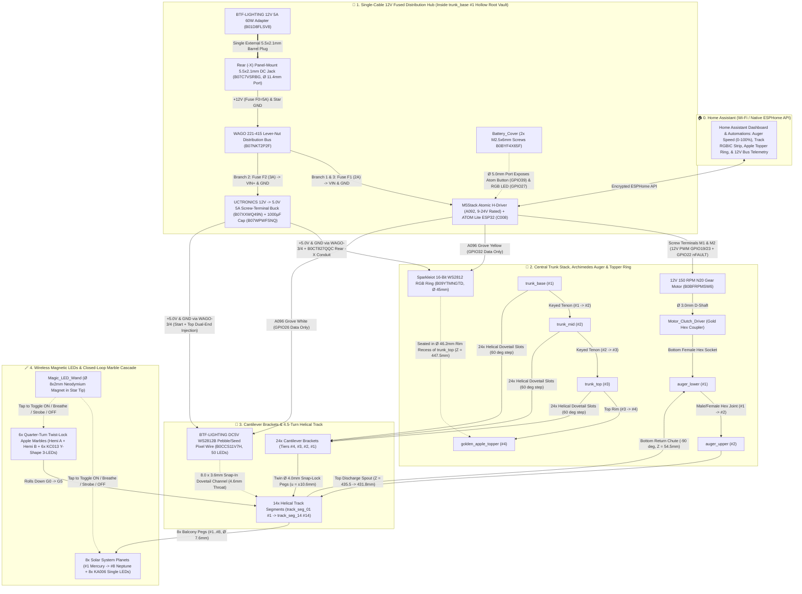

# 🛒 Complete Shopping List (Bill of Materials & Where to Buy)

Everything required to build, light, and control the tree in **Home Assistant (via ESPHome)** uses off-the-shelf components with **zero soldering** (only screw terminals and plug-in Grove/DuPont connectors). All legacy wired Bambu Lab hubs, switches, COB strips, and lamp pucks have been removed so you only buy what is used in the ESPHome model.

> 📖 **Full Electrical Engineering Reference:** See **[`POWER_ARCHITECTURE.md`](../POWER_ARCHITECTURE.md)** for the complete power budget, 3-branch fused wiring schematic, wire-gauge calculations, and multimeter commissioning checklist.

<!-- BOM:BEGIN -->

### 1. Electronics, Single-Cable 12V Power Distribution & Wireless Magnetic LEDs (100% Solder-Free)

| Qty | Status / Role | Part Number / ASIN | Component | Spec / Dimensions | Direct Product Link | Where It Goes in the Tree |
| :---: | :---: | :---: | :--- | :--- | :--- | :--- |
| **1×** | **Required *(New — Single External Supply)*** | **`B01D8FLSV8`** | **BTF-LIGHTING Regulated `12V DC 5A (60W)` Power Supply Adapter** | `100–240V AC` in → Regulated `12.0V DC, 5.0A (60W)` out, `5.5 × 2.1 mm` center-positive plug, AC wall cord included | [Amazon — BTF-LIGHTING `12V 5A 60W` Power Supply Adapter (`B01D8FLSV8`)](https://www.amazon.com/dp/B01D8FLSV8) | Single external power cord plugging into the rear `-X` `5.5 × 2.1 mm` DC barrel jack on [`trunk_base`](../cad/trunk.py) (`26.5W` max simultaneous peak load) |
| **1×** | **Required *(New — Panel DC Entry)*** | **`B07C7VSRBG`** | **Pre-Wired `5.5 × 2.1 mm` Threaded Panel-Mount DC Barrel Jack (`18 AWG` Leads)** | `12–24V DC`, `5A–10A` rated, `M11 × 0.75` (`Ø 11.0 mm`) thread with hex nut & pre-attached `18 AWG` red/black leads | [Amazon — 5.5 × 2.1 mm Threaded Panel-Mount DC Barrel Jack with Pre-Wired 18 AWG Leads (`B07C7VSRBG`)](https://www.amazon.com/dp/B07C7VSRBG) | Mounts into the **`Ø 11.4 mm` rear `-X` DC jack port** (`Z = 10.0 mm`) on [`trunk_base`](../cad/trunk.py); pigtails route internally into the Hollow Root Vault |
| **1×** | **Required *(New — 5V LED Rail)*** | **`B07XXWQ49N`** | **UCTRONICS `DC 9V–36V to 5.0V 5A (25W)` Buck Converter Module with Screw Terminals (`U6223`)** | `9–36V DC` in → Fixed **`5.0V DC, 5.0A (25W)`** out (`63 × 20 × 10 mm`) with onboard `VIN+/GND` and `OUT+/GND` screw terminals | [Amazon — UCTRONICS `DC 9V–36V to 5V 5A` Screw-Terminal Buck Converter (`B07XXWQ49N`)](https://www.amazon.com/UCTRONICS-Converter-Transformer-Voltage-Regulator/dp/B07XXWQ49N) | Seats inside the `Ø 135 × 50 mm` Hollow Root Vault on Branch 2 (`F2 = 3A` fuse) to power all 66 WS2812B LEDs without loading `C008`'s USB diode |
| **1× Pack** | **Required *(New — Solder-Free Bus)*** | **`B07NKT2P2F`** | **WAGO `221` Lever-Nut 15-Piece Assortment Pocket Pack (`221-412`, `221-413`, `221-415`)** | Includes `5× 221-415` (5-port), `5× 221-413` (3-port), and `5× 221-412` (2-port) lever connectors (`24–12 AWG`) | [Amazon — WAGO `221` Lever-Nut 15-Piece Assortment Pocket Pack (`B07NKT2P2F`)](https://www.amazon.com/dp/B07NKT2P2F) | Uses `2× 221-415` (`WAGO-1 +12V` & `WAGO-2 Star GND`) + `2× 221-413` (`WAGO-3 +5V LED` & `WAGO-4 LED GND`) for 100% tool-free distribution |
| **1× Kit** | **Required *(New — Branch Fuses)*** | **`B087BT1PH3`** | **Bst4U 6-Pack Inline Blade Fuse Holders + 100-Piece Blade Fuse Assortment Kit (`2A, 3A, 5A` Included)** | `6×` pre-wired inline blade fuse holders with protective caps + `100×` blade fuses (`2A, 3A, 5A, 7.5A, 10A, 15A, 20A, 25A, 30A, 35A`) | [Amazon — Bst4U 6-Pack Inline Blade Fuse Holders + 100pc Fuse Kit (`B087BT1PH3`)](https://www.amazon.com/dp/B087BT1PH3) | Uses `3×` inline fuse holders inside the Hollow Root Vault: **`F0 = 5A`** (main `12V` input), **`F1 = 2A`** (`A092` controller/motor), and **`F2 = 3A`** (`5V` LED buck) |
| **1× Pack** | **Required *(New — 5V Bulk Cap)*** | **`B07WPWFSNQ`** | **BOJACK `1000 µF 16V` `105 °C` Radial Electrolytic Capacitors (10-Pack)** | `1000 µF`, `16V DC`, `105 °C` low-ESR radial aluminum electrolytic capacitor (`Ø 10 × 17 mm`) | [Amazon — BOJACK `1000 µF 16V 105°C` Radial Electrolytic Capacitors (`B07WPWFSNQ`)](https://www.amazon.com/dp/B07WPWFSNQ) | **1×** capacitor has its `+` and `-` leads clamped directly into the `OUT+` and `GND` screw terminals of the `B07XXWQ49N` `5V` buck converter |
| **1×** | **Existing *(Retained)*** | **`A092`** | **M5Stack Atomic H-Bridge Driver Base (`DRV8876`)** | `48.0 × 24.0 × 18.0 mm`, **`9–24V DC` input**, TI `DRV8876` H-Bridge (`1.5A` cont / `2.0A` peak), internal `MP1584EN` `12V→5V` buck for `C008`, `HT3.96-4P` screw terminals (`M1`, `M2`, `VIN`, `GND`) | [M5Stack Store — Atomic H-Bridge Driver Base (`A092`)](https://shop.m5stack.com/products/atomic-h-bridge-driver-base-drv8876) | Seats into the stepped `-Y` bottom ESPHome bay (`49.2 × 25.2 × 20.3 mm`) of [`trunk_base`](../cad/trunk.py); powered by **`12.0V DC`** on `VIN`/`GND` via Fuse `F1 (2A)` |
| **1×** | **Existing *(Retained)*** | **`C008`** | **M5Stack ATOM Lite ESP32 Development Kit** | `24.0 × 24.0 × 9.5 mm` `ESP32-PICO-D4` Wi-Fi/BLE controller with `HY2.0-4P` Grove port, `SK6812` RGB LED & button | [M5Stack Store — ATOM Lite ESP32 (`C008`)](https://shop.m5stack.com/products/atom-lite-esp32-development-kit) | Snaps onto `A092` (powered internally from `A092`'s `12V→5V` regulator; USB-C needed only for initial flashing of [`esphome/grav-mass-tree.yaml`](../esphome/grav-mass-tree.yaml)) |
| **1×** | **Existing *(Retained)*** | **`A096`** | **M5Stack Grove2Dupont Conversion Cable (`20 cm, 5 Pairs`)** | Male `HY2.0-4P` Grove plug to 4× 2.54 mm DuPont pins (`Black=GND`, `White=G26`, `Yellow=G32`, `Red=+5V` capped/isolated) | [M5Stack Store — Grove2Dupont Conversion Cable (`A096`)](https://shop.m5stack.com/products/grove2dupont-conversion-cable-20cm-5pairs) | Plugs into `C008` Grove port to carry **`White = GPIO26` Track Data**, **`Yellow = GPIO32` Topper Data**, and **`Black = Signal GND`** (`Red +5V` is capped to prevent backfeeding!) |
| **1×** | **Required *(New — 12V Auger Motor)*** | **`B0BFRPMSW6`** | **`12V DC 150 RPM N20` Micro Metal Gear Motor (`Ø 3.0 mm` D-Shaft)** | `10 × 12 × 25 mm` metal gearbox (100% identical size to `LA002`), **`12.0V DC` rated**, `150 RPM`, `0.90 kg·cm` torque, `Ø 3.0 mm` D-shaft | [Amazon — `12V DC 150 RPM N20` Micro Metal Gear Motor, `Ø 3mm` D-Shaft (`B0BFRPMSW6`)](https://www.amazon.com/dp/B0BFRPMSW6) | Drops directly into [`trunk_base`](../cad/trunk.py) & [`Servo_Or_030_Adapter`](../cad/auger.py) and clamps straight into `A092` **`M1` & `M2`** (`12V` native PWM)! |
| **1×** | **Existing *(Retained)*** | **`B0CCS11V7H`** | **BTF-LIGHTING `DC5V` Addressable `WS2812B` RGB Pebble / Seed Pixel Flexible Wire (`16.4ft / 50 LEDs`, Track)** | `360°`-flexible 3-wire cord with `50×` `6.2 × 3.2 mm` oval epoxy RGB LED drops (`5V`, `5W` nominal / `9W` max white), 3-pin `JST-SM` + start/end power-injection leads | [Amazon — BTF-LIGHTING `DC5V` `WS2812B` Pebble/Seed Pixel Flexible Wire (`B0CCS11V7H`)](https://www.amazon.com/dp/B0CCS11V7H) | Snaps into the **`8.0 × 3.6 mm` dovetail channel (`4.6 mm` throat)** under [`track_seg_01`](../cad/track.py)..[`14`](../cad/track.py); powered from `5V` Buck (`WAGO-3/4`), Data from **`GPIO26` (White)** |
| **1×** | **Existing *(Retained)*** | **`B09YTMNGTD`** | **Sparkleiot 16-Bit WS2812 RGB LED Ring with `SM2.54-3P` Wire (Apple Topper)** | `Ø 45.0 mm` OD × `Ø 32.0 mm` ID addressable 16-LED 5V RGB ring (`4.8W` max white) with pre-wired 3-pin `JST-SM` (`SM2.54-3P`) plug | [Amazon — Sparkleiot 16-Bit WS2812 RGB LED Ring (`B09YTMNGTD`)](https://www.amazon.com/dp/B09YTMNGTD) | Seats flat in the **`Ø 46.2 × 2.5 mm` top rim recess** of [`trunk_top`](../cad/trunk.py) (`Z = 447.5 mm`) inside [`golden_apple_topper`](../cad/topper_planets.py); powered from `5V` Buck, Data from **`GPIO32` (Yellow)** |
| **1×** | **Existing *(Retained)*** | **`B0CT827QQC`** | **3-Pin `JST-SM` (`SM2.54-3P`) Male-to-Female Extension Cable (`1 m`)** | 3-pin `JST-SM` plug-and-play extension wire (`5V`, `GND`, `DATA`) | [Amazon — BTF-LIGHTING 3-Pin JST-SM Extension Cable (`B0CT827QQC`)](https://www.amazon.com/dp/B0CT827QQC) | Plugs into the Sparkleiot Topper Ring (`zero soldering`), threads down the **`10 × 8 mm` rear `-X` trunk conduit**, and connects to `WAGO-3/4` (`5V`/`GND`) + **`GPIO32` (Yellow)** |
| **6×** | **Existing *(Retained)*** | **`KC013`** | **Bambu Lab Y-Shape LED Light with Magnetic Control Switch — Warm White (6 Rolling Apple Marbles)** | `Ø 18.0 × 6.5 mm` 3-LED Y-board (`CR1632` battery + `Ø 8 × 2 mm` magnet included) | [Bambu Lab Store — Y-Shape LED Light with Magnetic Control Switch (`KC013`)](https://us.store.bambulab.com/products/y-shape-led-light-with-magnetic-control-switch) | **6×** drop into the **`Ø 18.70 × 7.30 mm`** equatorial chamber of the 6 Quarter-Turn Bayonet Twist-Lock Marbles (`Apple_Hemisphere_A` + `B`) |
| **8×** | **Existing *(Retained)*** | **`KA006`** | **Bambu Lab Single LED Magnetic Control Switch Light (8 Solar System Planets)** | `Ø 7.5 × 6.0 mm` single-LED (`CR927` battery + `Ø 8 × 2 mm` magnet included) | [Bambu Lab Store — Single LED Magnetic Control Switch Light (`KA006`)](https://us.store.bambulab.com/products/single-led-magnetic-control-switch-light) | **8×** press-fit into the `Ø 8.0 × 10.0 mm` bottom bores of the 8 Solar System planets (`planet_mercury..neptune`); **1×** magnet presses into [`Magic_LED_Wand`](../cad/topper_planets.py) |
| *Optional* | *Optional Telemetry* | **`U190`** | **M5Stack Unit `INA226-10A` High-Precision Current/Voltage/Power Sensor** | `0–30V DC`, `±10A`, `HT3.96-4P` screw terminals + Grove `HY2.0-4P` I2C (`0x41`) | [M5Stack Store — Unit `INA226-10A` (`U190`)](https://shop.m5stack.com/products/ina226-voltage-and-current-measurement-unit-10a) | Clamps inline with the `5V` LED buck output (`GPIO21`/`GPIO25` I2C header) for real hardware current/power measurement in ESPHome |
| *Optional* | *Spare Marble Cells* | **`B07V5CW1MG`** | **LiCB `CR1632` 3V Lithium Coin Cell Batteries (5-Pack)** | `CR1632` (`Ø 16.0 × 3.2 mm`, `3V`) for `KC013` Y-Shape Marble LEDs | [Amazon — LiCB `CR1632` 3V Lithium Coin Cells, 5-Pack (`B07V5CW1MG`)](https://www.amazon.com/dp/B07V5CW1MG) | Spare coin-cell batteries for the 6 wireless glowing marbles (`KC013`) |
| *Optional* | *Spare Planet Cells* | **`B0CMCFGXSL`** | **Tenergy `CR927` 3V Lithium Button Cell Batteries** | `CR927` (`Ø 9.5 × 2.7 mm`, `3V`) for `KA006` Planet LEDs | [Amazon — Tenergy `CR927` 3V Lithium Button Cells (`B0CMCFGXSL`)](https://www.amazon.com/dp/B0CMCFGXSL) | Spare coin-cell batteries for the 8 wireless Solar System planets (`KA006`) |

---

### 2. Fasteners (Only 2 Screws Needed!)

| Qty | Part Number / ASIN | Component | Spec / Dimensions | Direct Product Link | Purpose |
| :---: | :---: | :--- | :--- | :--- | :--- |
| **2×** | **`B0BYF4X65F`** | **MonsterBolts `M2.5 × 6 mm` Button Head Cap Machine Screws (BHCS)** | `M2.5 × 6 mm` stainless steel button head machine screws | [Amazon — MonsterBolts M2.5 × 6mm Button Head Screws, 50-Pack (`B0BYF4X65F`)](https://www.amazon.com/dp/B0BYF4X65F) | Secures [`Battery_Cover`](../output/Battery_Cover.stl) to the bottom of `trunk_base` |

---

### 3. 3D Printing Filament (Snapmaker U1 4-Toolhead Palettes — Max 4 Colors Per Plate)

| Toolhead / Role | Color & Finish | Material | Est. Weight | Spools Needed | Direct Product Link |
| :---: | :--- | :---: | :---: | :---: | :--- |
| **Core Tree `T1`** *(Plates 1–4, 16, 17)* | **Matte Dark Brown (`11801`)** (`#4A2F1D`) | PLA | ~1,150 g | **2× 1 kg spools** | [Bambu Lab Store — PLA Matte (`Dark Brown 11801`)](https://us.store.bambulab.com/products/pla-matte) |
| **Core Tree `T2`** *(Plates 5–13, 16, 18)* | **Translucent Teal (`32501`)** (`#00A86B`) | PETG | ~1,080 g | **2× 1 kg spools** | [Bambu Lab Store — PETG Translucent (`Translucent Teal 32501`)](https://us.store.bambulab.com/products/petg-translucent) |
| **Core Tree `T3`** *(Plates 14, 16, 17, 18)* | **Silk+ Gold (`13405`)** (`#D4AF37`) | PLA | ~125 g | **1× 1 kg spool** | [Bambu Lab Store — PLA Silk+ (`Gold 13405`)](https://us.store.bambulab.com/products/pla-silk-upgrade) |
| **Core Tree `T4`** *(Plates 15, 16, 17)* | **Basic Red (`10200`)** (`#C41E3A`) | PLA | ~155 g | **1× 1 kg spool** | [Bambu Lab Store — PLA Basic (`Red 10200`)](https://us.store.bambulab.com/products/pla-basic-filament) |
| **Planet Accent** *(Plate 17 `T2` & Plate 18 `T3`)* | **Matte Ivory White (`11100`)** (`#F5EFE6`) | PLA | ~35 g | **1× 1 kg spool** | [Bambu Lab Store — PLA Matte (`Ivory White 11100`)](https://us.store.bambulab.com/products/pla-matte) |
| **Ocean/Ice Planet Accent** *(Plate 18 `T1`)* | **Matte Marine Blue (`11600`)** (`#1E5AA8`) | PLA | ~30 g | **1× 1 kg spool** | [Bambu Lab Store — PLA Matte (`Marine Blue 11600`)](https://us.store.bambulab.com/products/pla-matte) |

<!-- BOM:END -->

---

## 🗺️ Complete Mechanical & Electrical Connection Diagram (One-Cable 12V Solder-Free Edition)

