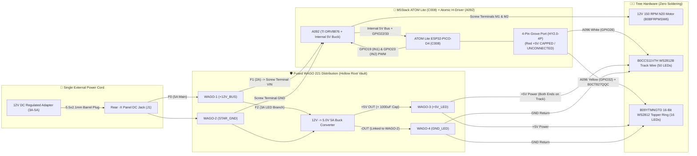

# 🏠 Smart Home Integration (ESPHome + Home Assistant — Single-Cable 12V, Zero Soldering)

You can operate the entire tree as a native **ESPHome** device in **Home Assistant**—with **continuous 0–100% PWM auger speed control**, **1-tap reverse anti-jam**, **`12V` bus voltage & hardware fault telemetry**, and **17 addressable RGBIC LED cascade effects**—from **one external `12V DC` power cable** with **100% solder-free internal connections**.

> 📄 **Complete Electrical Engineering Reference:** See **[`POWER_ARCHITECTURE.md`](../POWER_ARCHITECTURE.md)** for the full power budget table, branch fuse schedule, wire-gauge & voltage-drop calculations, Option B vs. Option A motor trade-off analysis, and 6-stage multimeter commissioning checklist.

## 0. Electrical Architecture & Voltage Compatibility (`12V` Input + Isolated `5V` LED Buck)

1. **Why a Single `12V DC` Supply + Dedicated `5V` Buck Converter Is Used:**
   - **`M5Stack Atomic H-Bridge Driver Base (A092)` Input Requirement:** `A092` is specified for **`DC 9–24V` input** (its TI `DRV8876` H-bridge has a `4.15V–4.5V` UVLO threshold, and its internal `MP1584EN` buck regulator requires headroom above `5V` to power the stacked `C008` ATOM Lite). Feeding `12V DC` (`B01D8FLSV8`) into `A092` `VIN/GND` operates `A092` in the center of its official `9–24V` envelope and automatically powers `C008` without needing a USB-C cord during normal operation.
   - **Dedicated UCTRONICS `12V → 5.0V 5A` LED Buck Converter (`B07XXWQ49N` / `U6223`, `63.0 × 27.0 × 10.0 mm`, `5V` Rail Isolation):** `C008`'s USB-C port has a `500 mA` Schottky diode limit (`D1`) and `A092`'s onboard `5V` regulator is sized only for ESP32 logic. Powering the 50 Track LEDs (`B0CCS11V7H`) and 16 Topper LEDs (`B09YTMNGTD`) from the dedicated **`UCTRONICS DC 9V–36V to 5.0V 5A` screw-terminal buck converter (`B07XXWQ49N`, `63.0 × 27.0 × 10.0 mm`)** inside the Hollow Root Vault provides up to `2,760 mA` (`100%` full white) with zero stress on `C008` or `A092`. **Never connect the external `5V` buck output to `C008`/`A092`'s `5V` pin (leave the `A096` Grove `Red` wire capped/disconnected).**
   - **`12V DC 150 RPM N20` Auger Motor (`B0BFRPMSW6` on `A092` `M1/M2`):** Because `A092`'s `DRV8876` switches `VIN` (`12V`) directly to `M1/M2`, using the **`12V DC 150 RPM N20` Micro Metal Gear Motor (`B0BFRPMSW6`, `10 × 12 × 25 mm`, `Ø 3.0 mm` D-shaft)** allows direct connection to `A092` `M1/M2` at its native `12V` rating while preserving `GPIO22` (`nFAULT`) stall detection.

## 1. Zero-Solder Parts List for ESPHome / Home Assistant

All electronics, power distribution hardware, and fasteners for the ESPHome / Home Assistant build are maintained in a single machine-generated Bill of Materials in **[`docs/BOM.md`](BOM.md)**:

- **12V Power Entry, 5V Buck Converter & Fused WAGO Distribution:** See **[`docs/BOM.md` — Section 1 (Electronics)](BOM.md#1-electronics-single-cable-12v-power-distribution--wireless-magnetic-leds-100-solder-free)** for rows `B01D8FLSV8`, `B07C7VSRBG`, `B07XXWQ49N`, `B07NKT2P2F`, `B087BT1PH3`, and `B07WPWFSNQ`.
- **M5Stack ESP32 Controller, H-Bridge Driver & 12V N20 Auger Motor:** See **[`docs/BOM.md` — Section 1 (Electronics)](BOM.md#1-electronics-single-cable-12v-power-distribution--wireless-magnetic-leds-100-solder-free)** for rows `A092` ([Official M5Stack Pinout Docs](https://docs.m5stack.com/en/atom/Atomic_HDriver_Base)), `C008`, `A096`, and `B0BFRPMSW6`.
- **Addressable WS2812B LEDs & Optional I2C Current Telemetry:** See **[`docs/BOM.md` — Section 1 (Electronics)](BOM.md#1-electronics-single-cable-12v-power-distribution--wireless-magnetic-leds-100-solder-free)** for rows `B0CCS11V7H`, `B09YTMNGTD`, `B0CT827QQC`, and optional `U190`.
- **Base Service Cover Screws:** See **[`docs/BOM.md` — Section 2 (Fasteners)](BOM.md#2-fasteners-only-2-screws-needed)** for row `B0BYF4X65F`.

## 2. Zero-Solder Pinout & Terminal Map (`A092` + `C008` + `5V` Buck Inside `trunk_base`)



| Tree Component | Connection Inside `trunk_base` (`A092` + `C008` + WAGO `221`) | ESP32 Pin | Home Assistant Entity |
| :--- | :--- | :---: | :--- |
| **`12V` Main Power Input (`J1` → `A092`)** | Rear `-X` DC Barrel Jack (`J1`, `B07C7VSRBG`) → `F0 (5A)` → `WAGO-1 (+12V_BUS)` → `F1 (2A)` → `A092` **`VIN`** & **`GND`** screw terminals *(powers both `A092` and `C008` internally)* | `VIN ADC = GPIO33`<br>`nFAULT = GPIO22` | `sensor.motor_bus_voltage_12v_vin` (`vin_12v_bus_voltage`), `binary_sensor.12v_supply_voltage_out_of_range_alert` (`supply_12v_rail_fault`) & `binary_sensor.auger_motor_fault_stall_alert` (`motor_driver_fault`) |
| **N20 Auger Lift Motor (`12V 150 RPM`, `B0BFRPMSW6`)** | Clamp `12V 150 RPM N20` motor leads directly into `A092` **`M1`** & **`M2`** screw terminals | `IN1 = GPIO19`<br>`IN2 = GPIO23` | `fan.auger_lift_motor` *(0–100% PWM speed + Forward/Reverse)* |
| **BTF-LIGHTING `B0CCS11V7H` `WS2812B` Pebble Wire (Track)** | **Data:** `A096` Grove **`White = GPIO26`** → center `DIN` pin.<br>**Power:** `WAGO-3 (+5V_LED)` & `WAGO-4 (GND_LED)` from `B07XXWQ49N` `12V→5V 5A` buck → both start & end injection leads *(leave `A096` `Red +5V` capped!)* | `GPIO26` | `light.helical_track_rgbic_cob_strip` *(with 11 animations including `Gravity Accelerating Apple Comet`)* |
| **Sparkleiot `B09YTMNGTD` 16-Bit WS2812 Ring (Apple Topper)** | **Data:** `A096` Grove **`Yellow = GPIO32`** → center `DIN` pin of `B0CT827QQC` extension in rear `-X` conduit.<br>**Power:** `WAGO-3 (+5V_LED)` & `WAGO-4 (GND_LED)` from `B07XXWQ49N` `12V→5V 5A` buck | `GPIO32` | `light.golden_apple_topper_ring` *(16-LED RGB Halo with 6 animations)* |
| **Built-In Base Button & RGB LED** | Accessible through the **`Ø 5.0 mm` center port** on [`Battery_Cover`](../output/Battery_Cover.stl) | `Btn = GPIO39`<br>`LED = GPIO27` | `binary_sensor.tree_base_button` & `light.base_status_led` |

## 3. Flashing the Included ESPHome Configuration ([`esphome/grav-mass-tree.yaml`](../esphome/grav-mass-tree.yaml))
A complete, ready-to-flash ESPHome configuration engineered for the **Single-Cable `12V` Power Architecture** with **17 custom animations** is provided in [`esphome/grav-mass-tree.yaml`](../esphome/grav-mass-tree.yaml):
```bash
esphome run esphome/grav-mass-tree.yaml
```
Once flashed, unplug the USB-C cable and run the tree from the single rear `12V DC` barrel jack. Home Assistant automatically discovers the tree with:
- **🛡️ `12V` Supply Rail Telemetry, Hardware INA226 Sensor Support & Active `5V` Current Governor (`select.5v_led_buck_current_limit_profile`):**
  - Monitors the incoming **`12V` DC bus voltage** on `GPIO33` (`sensor.motor_bus_voltage_12v_vin`, with `10.8V` undervoltage and `13.5V` overvoltage protection), supports plug-and-play hardware current/voltage/power telemetry via the **`M5Stack Unit INA226-10A (U190)`** (`sensor.measured_5v_led_buck_current_ina226_hardware`), and runs a `250 ms` software current governor (`sensor.estimated_5v_led_current_approximate_software_model`, defaulting to **`2000 mA` (`Nominal 5V Buck Mode — Default`)**) that strictly enforces the selected ceiling across all brightness levels. Also includes **350 ms staggered motor-first soft-start**.
- **🎄 `select.tree_master_scene` (8 One-Tap Synchronized Motor + Lighting Scenes):**
  - `Falling Apple Cascade (Motor 65% + Gravity Comet)`
  - `Solar System Grand Tour (Motor 70% + 8-Planet Orbit + Sun Halo)`
  - `Grav-Mass Holiday Spiral (Motor 65% + Candy Cane + Heartbeat)`
  - `Newton Opticks Prism (Motor 80% + Rainbow Cascade + Prism Halo)`
  - `Cozy Firelight Evening (Motor 45% Quiet + Hearth Flicker)`
  - `Aurora Borealis Nightlight (Motor Off + Northern Lights)`
  - `Galileo Gravity Lab Mode (Motor 60% + Timing Gate Beacons)`
  - `Off`
- **🌈 `light.helical_track_rgbic_cob_strip` (11 Track Animations on `GPIO26`):** `Gravity Accelerating Apple Comet` ($s = \frac{1}{2}gt^2$), `Solar System 8-Planet Orbit`, `Grav-Mass Candy Cane Spiral`, `Newton Rainbow Cascade`, `Falling Apple Cascade`, `Warm Firelight Hearth`, `Aurora Borealis Wave`, `Galileo Timing Gate Beacons`, `Emerald Orbit Pulse`, `Solar System Starlight`, and `Grav-Mass Fireworks`.
- **🍎 `light.golden_apple_topper_ring` (6 Topper Halo Animations on `GPIO32`):** `Crimson & Gold Heartbeat`, `Spinning Golden Sun Halo`, `Newton Halo Spin`, `Flickering Apple Lantern`, `Aurora Crown`, and `Starlight Crown`.
- **🔘 Multi-Function Physical Base Button (`GPIO39`):**
  - **Single Short Click:** Cycles through the 7 signature scenes without needing a phone.
  - **Double Click:** Toggles the **Auger Motor** ON/OFF (so you can run the tree as a silent illuminated nightlight or start the marble cascade).
  - **Long Press (`>= 1.2 s`):** Turns the entire tree OFF.
- **⚙️ `fan.auger_lift_motor` & `button.unjam_auger_reverse_1_5s_resume`:** Variable `0–100%` PWM speed slider, hardware stall/fault auto-cutoff (`GPIO22`), and 1-tap `1.5 s` reverse anti-jam.
